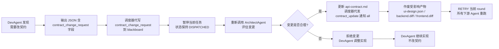

# Orchestrator：调度器设计

> 本文件不再是"一个 Agent 角色定义"，而是**调度器（Scheduler）的设计文档**。
> 调度器是一个确定性 Workflow Engine（代码逻辑），在特定节点嵌入 LLM 决策点，子 Agent 以工具方式被按需调用。

---

## 1. 定位与核心原则

### 1.1 定位

调度器 = **确定性执行系统 + 嵌入式 LLM 决策点**。

```
调度器（代码逻辑，非常驻 LLM 会话）
  ├── 状态机驱动（硬编码转换规则，见 .loop/state-machine.md）
  ├── 闸门执行器（执行任务卡声明的 check 命令）
  ├── 产物收集（写入 .loop/artifacts/）
  ├── 重试/回滚控制
  │
  └── 在特定节点嵌入 LLM 决策点（按需新开会话）：
      ├── 需求拆解节点    → 调用 SpecAgent
      ├── 任务分配节点    → 调用 Orchestrator-LLM（做分配决策）
      ├── 架构决策节点    → 调用 ArchitectAgent
      ├── UI 设计节点     → 调用 UIDesignAgent
      ├── 代码实现节点    → 调用 DevAgent（Backend/Frontend/Client，按项目类型激活）
      ├── 测试节点        → 调用 TestAgent
      ├── 评审节点        → 调用 ReviewAgent
      └── 部署节点        → 调用 DevOpsAgent
```

### 1.2 五大核心原则

| 原则 | 含义 |
|------|------|
| **Agent 不保存主状态** | LLM 无状态，所有状态存在调度器侧 |
| **任务状态在调度器** | 任务卡的 `status` / `round` / `retry_count` 由调度器维护 |
| **上下文在 artifact store** | 交接传引用不传内容，上下文存在 `.loop/artifacts/` |
| **交接靠结构化产物** | Agent 输出必须是结构化 JSON，存入 artifact store |
| **质量靠审核节点 + 失败靠重试策略** | 三层闸门 + 回滚 checkpoint + 重试上限 |

---

## 2. 调度器架构组件

### 2.1 组件总览

```
┌─────────────────────────────────────────────────────────────┐
│                     调度器（Scheduler）                      │
│                                                             │
│  ┌─────────────┐  ┌─────────────┐  ┌─────────────────────┐ │
│  │ 状态机引擎  │  │ 闸门执行器  │  │  Agent 调用器        │ │
│  │ (State      │  │ (Gate       │  │  (Agent Invoker)   │ │
│  │  Engine)    │  │  Executor)  │  │                     │ │
│  └──────┬──────┘  └──────┬──────┘  └──────────┬──────────┘ │
│         │                │                    │            │
│  ┌──────▼────────────────▼────────────────────▼──────────┐ │
│  │              产物管理器（Artifact Manager）            │ │
│  └──────┬──────────────────────────────────────┬─────────┘ │
│         │                                      │          │
│  ┌──────▼──────┐                     ┌──────────▼────────┐ │
│  │ 重试/回滚    │                     │  运行时上下文      │ │
│  │ 控制器       │                     │  (Runtime Ctx)    │ │
│  └─────────────┘                     └───────────────────┘ │
└─────────────────────────────────────────────────────────────┘
```

### 2.2 各组件职责

| 组件 | 职责 | 实现方式 |
|------|------|---------|
| **状态机引擎** | 读取任务卡 `status`，决定下一步进入哪个节点；拒绝非法状态跳转 | 确定性代码（转换表查表） |
| **闸门执行器** | 解析任务卡 Done 项的 `check` 命令，执行，判定 pass/fail | 确定性代码（shell 执行） |
| **Agent 调用器** | 新开 LLM 会话，注入上下文包，收集结构化输出 | 新开会话 + 注入 prompt |
| **产物管理器** | 将 Agent 输出存入 `.loop/artifacts/{project}/{task_id}/{round}/` | 文件系统写入 |
| **重试/回滚控制器** | 记录 retry_count，回滚到 checkpoint，决定 RETRY/ESCALATED | 确定性代码 |
| **运行时上下文** | 当前任务卡、当前 round、当前状态、累计 token 消耗 | 内存对象 + 落盘 |

---

## 3. 状态机驱动

> **硬性强制**：`transition_to()` 已在 `.loop/state-machine.md` §5 强制产物完整性校验。
> 任何状态转换前必须校验产物齐全 + Agent 覆盖率 + Done 项状态，**不满足拒绝转换**。
> Layer 0 人工模式同样适用，无例外。完整校验清单见 `.loop/checklists/layer-0-must-run.md`。

### 3.1 调度器主循环（伪代码）

> **多子任务链路模型（C-1/C-3/H-1/H-3/F-3/F-4 修复 v3）**：
> - 任务卡新增字段：`phase`（architecture|development）、`arch_round`（架构阶段完成的 round 号，默认 1）、`current_subtask`（开发子任务索引，0-based）、`executed_agents_arch`（架构阶段已执行 Agent，完成后不可变）、`executed_agents_subtask`（当前开发子任务已执行 Agent，子任务切换时重置）。
> - 旧字段 `executed_agents` 保留为 `executed_agents_arch + executed_agents_subtask` 的合并视图，供向后兼容的校验函数使用。**M-5 修复**：合并视图由调度器在 DISPATCHED / AWAITING_AUTO_GATE / AWAITING_REVIEW 三个分支自动维护。
> - round 编号全局递增：round-0 = spec+assignment（全局产物）；round-1 = 架构阶段（architecture/env-check/gate/review）；round-2+ = 开发子任务（每个子任务可能因 RETRY 占用多个 round）。
> - 全局产物（spec.json/assignment.json）始终从 round-0 读取；架构阶段产物（architecture.json/env-check-result.json）从 `arch_round` 读取；开发产物从 `task_card.round` 读取。
>
> **F-3 修复（DevOpsAgent 纳入 assigned_to 列表调度）**：
> - DevOpsAgent 不再依赖 APPROVED→DISPATCHED 路径（状态机无此转换）。
> - DevOpsAgent 纳入 `subtasks[i].assigned_to` 列表排在最后，通过 PENDING→DISPATCHED 调度。
> - 前序 Agent 的 review APPROVE 由状态机保证，DevOpsAgent 被分配时所有前序 Agent 已通过 L1+L2。
>
> **F-4 修复（gate-auto / review-agent 追加到 executed_agents）**：
> - gate-auto 在 AWAITING_AUTO_GATE 分支执行后，由调度器追加到对应阶段的 executed_agents 列表。
> - review-agent 在 AWAITING_REVIEW 分支执行后，由调度器追加到对应阶段的 executed_agents 列表。
> - 这两个 Agent 不在 `subtasks[i].assigned_to` 列表中（状态机自动触发），但必须出现在 executed_agents 中以通过 DONE 覆盖率校验。
>
> **C-1 v2 修复（子任务内多 Agent 串行调度）**：
> - `assignment.json` 的 `subtasks[i].assigned_to` 是一个 **Agent 列表**（按 execution_order 顺序执行），不是单个 Agent。
> - 调度器维护 `current_subtask`（子任务索引）+ `executed_agents_subtask`（当前子任务已执行 Agent 列表），每次 APPROVED 后先检查当前子任务是否还有未执行 Agent：
>   - 有 → 回到 PENDING 分配下一个 Agent（同子任务内串行，round++）
>   - 无 → 检查是否所有子任务完成（`all_subtasks_done`）→ DONE 或 increment subtask
> - 不再"每次 APPROVED 后直接 current_subtask++"，避免跳过同子任务内的后续 Agent。
>
> **H-3 修复（SpecAgent/Orchestrator-LLM 走完整状态机）**：
> - 架构阶段不再在 PENDING 内连续调用 SpecAgent + Orchestrator-LLM 后直接 DISPATCHED 给 architect-agent。
> - 每个 Agent（含 SpecAgent / Orchestrator-LLM）走完整状态机：PENDING → DISPATCHED → RUNNING → AWAITING_AUTO_GATE → AWAITING_REVIEW → APPROVED。
> - 为 spec.json / assignment.json 增加 L1 Schema 校验（gate-auto 模式 `schema_check`，非 shell_exec）。
> - PENDING 分支按 `executed_agents_arch` 顺序分配下一个未执行的架构阶段 Agent。

```
# 辅助函数：读取 assignment.json（从 round-0 全局产物读取）
function read_assignment(task_card):
    return read_json(f".loop/artifacts/{task_card.project}/{task_card.id}/round-0/assignment.json")

# 辅助函数：检查所有子任务是否全部完成（C-1 v2 修复：定义实现）
function all_subtasks_done(task_card, assignment):
    """检查所有开发子任务是否完成。
    判定标准：current_subtask 是最后一个子任务，且其所有 Agent 已执行完。

    S-2 修复：subtasks[i].assigned_to 应包含子任务内所有需要通过 PENDING 分配的 Agent：
    ui-design-agent / backend-dev / frontend-dev(或 client-dev) / test-agent / devops-agent。
    不包含 gate-auto / review-agent（由状态机自动触发，在 AWAITING_AUTO_GATE /
    AWAITING_REVIEW 分支追加到 executed_agents_subtask，见 F-4 修复）。
    check_agent_coverage 会独立校验 gate-auto / review-agent 的覆盖率。"""
    if task_card.current_subtask < len(assignment.subtasks) - 1:
        return False  # 还有未到达的子任务
    # 当前是最后一个子任务，检查其所有 Agent 是否执行完
    current_agents = assignment.subtasks[task_card.current_subtask].assigned_to
    return all(a in task_card.executed_agents_subtask for a in current_agents)

function run_task(task_card):
    load task_card into runtime_ctx
    # 初始化多子任务字段（首次加载时）
    if task_card.executed_agents_arch is None:
        task_card.executed_agents_arch = []
        task_card.executed_agents_subtask = []
        task_card.current_subtask = 0
        task_card.arch_round = 1  # 默认架构阶段 round=1

    while runtime_ctx.status not in [DONE, FAILED, ESCALATED]:
        case runtime_ctx.status:
            PENDING:
                if task_card.phase == "architecture":
                    # 架构阶段：按序 SpecAgent → Orchestrator-LLM → ArchitectAgent
                    # H-3 修复：每个 Agent 走完整状态机（含 L1+L2 质检），
                    # 不再在 PENDING 内连续调用多个 Agent 后直接 DISPATCHED 给 architect-agent
                    if "spec-agent" not in task_card.executed_agents_arch:
                        runtime_ctx.assigned_to = "spec-agent"
                    elif "orchestrator-llm" not in task_card.executed_agents_arch:
                        runtime_ctx.assigned_to = "orchestrator-llm"
                    else:
                        runtime_ctx.assigned_to = "architect-agent"
                else:
                    # 开发阶段：查找当前子任务中下一个未执行的 Agent
                    # C-1 v2 修复：子任务内 Agent 按 assigned_to 顺序串行调度
                    assignment = read_assignment(task_card)
                    subtask = assignment.subtasks[task_card.current_subtask]
                    remaining = [a for a in subtask.assigned_to
                                 if a not in task_card.executed_agents_subtask]
                    if remaining:
                        runtime_ctx.assigned_to = remaining[0]
                    else:
                        # 当前子任务所有 Agent 已执行完（不应到这里，APPROVED 分支应已处理）
                        # 兜底：进入下一子任务或 DONE
                        if task_card.current_subtask + 1 < len(assignment.subtasks):
                            task_card.current_subtask += 1
                            task_card.executed_agents_subtask = []
                            task_card.round += 1
                            continue  # 重新进 PENDING
                        else:
                            transition_to(DONE)
                            continue
                transition_to(DISPATCHED)

            DISPATCHED:
                artifact_refs = build_context_pack(task_card)
                result = invoke_agent(assigned_to, artifact_refs)
                save_artifact(result)
                # 记录到对应阶段的 executed_agents
                if task_card.phase == "architecture":
                    task_card.executed_agents_arch.append(assigned_to)
                else:
                    task_card.executed_agents_subtask.append(assigned_to)
                # M-5 修复：维护 executed_agents 合并视图（供向后兼容的校验函数使用）
                task_card.executed_agents = task_card.executed_agents_arch + task_card.executed_agents_subtask
                # M-3 修复：调度器代写 Blackboard 消息（agent_dispatched）
                write_blackboard({
                    type: "agent_dispatched",
                    task_id: task_card.id,
                    agent: assigned_to,
                    round: task_card.round,
                    phase: task_card.phase,
                    subtask: task_card.current_subtask,
                    timestamp: now()
                })
                transition_to(AWAITING_AUTO_GATE)

            RUNNING:
                # Agent 执行中，等待结果（已在 DISPATCHED 内同步完成）
                # 此状态用于异步模式预留，首期为同步
                pass

            AWAITING_AUTO_GATE:
                # C-2 修复：gate 按 gate_stage 筛选当前 Agent 可执行的 Done 项
                gate_result = run_auto_gate(task_card.done_items, current_agent=task_card.assigned_to)
                # F-4 修复：gate-auto 执行后追加到对应阶段的 executed_agents
                if task_card.phase == "architecture":
                    if "gate-auto" not in task_card.executed_agents_arch:
                        task_card.executed_agents_arch.append("gate-auto")
                else:
                    if "gate-auto" not in task_card.executed_agents_subtask:
                        task_card.executed_agents_subtask.append("gate-auto")
                # M-5 修复：更新合并视图
                task_card.executed_agents = task_card.executed_agents_arch + task_card.executed_agents_subtask
                if gate_result.pass:
                    transition_to(AWAITING_REVIEW)
                else:
                    log gate_result.failures
                    # M-3 修复：调度器代写 Blackboard 消息（gate_failed）
                    write_blackboard({
                        type: "gate_failed",
                        task_id: task_card.id,
                        agent: task_card.assigned_to,
                        round: task_card.round,
                        failures: gate_result.failures,
                        timestamp: now()
                    })
                    transition_to(RETRY)

            AWAITING_REVIEW:
                review = invoke_agent(review-agent, latest_artifacts)
                save_artifact(review)
                # F-4 修复：review-agent 执行后追加到对应阶段的 executed_agents
                if task_card.phase == "architecture":
                    if "review-agent" not in task_card.executed_agents_arch:
                        task_card.executed_agents_arch.append("review-agent")
                else:
                    if "review-agent" not in task_card.executed_agents_subtask:
                        task_card.executed_agents_subtask.append("review-agent")
                # M-5 修复：更新合并视图
                task_card.executed_agents = task_card.executed_agents_arch + task_card.executed_agents_subtask
                if review.verdict == APPROVE:
                    # M-3 修复：调度器代写 Blackboard 消息（review_approved）
                    write_blackboard({
                        type: "review_approved",
                        task_id: task_card.id,
                        agent: task_card.assigned_to,
                        round: task_card.round,
                        timestamp: now()
                    })
                    transition_to(APPROVED)
                else:
                    # M-3 修复：调度器代写 Blackboard 消息（review_rejected）
                    write_blackboard({
                        type: "review_rejected",
                        task_id: task_card.id,
                        agent: task_card.assigned_to,
                        round: task_card.round,
                        issues: review.issues,
                        timestamp: now()
                    })
                    transition_to(REJECTED)

            APPROVED:
                if task_card.phase == "architecture":
                    # 架构阶段 APPROVED
                    # F-2 修复：先检查架构阶段是否还有未执行 Agent（同开发阶段逻辑）
                    arch_remaining = [a for a in ["spec-agent", "orchestrator-llm", "architect-agent"]
                                      if a not in task_card.executed_agents_arch]
                    if arch_remaining:
                        # 架构阶段还有 Agent 未执行 → 回到 PENDING 分配下一个
                        task_card.round += 1
                        transition_to(PENDING)
                    elif not task_card.env_check_done:
                        # 所有架构 Agent 已执行 + 首次架构 APPROVED → ENV_CHECK
                        transition_to(ENV_CHECK)
                    else:
                        # ENV_CHECK 已通过 → 切换到开发阶段
                        task_card.phase = "development"
                        task_card.arch_round = task_card.round  # 记录架构阶段 round
                        task_card.current_subtask = 0
                        task_card.executed_agents_subtask = []  # 重置开发阶段
                        task_card.round += 1  # 进入开发子任务的新 round
                        transition_to(PENDING)  # 进入开发子任务循环
                else:
                    # 开发阶段 APPROVED
                    # C-1 v2 修复：先检查当前子任务是否还有未执行 Agent，再决定 increment subtask 或 DONE
                    assignment = read_assignment(task_card)
                    subtask = assignment.subtasks[task_card.current_subtask]
                    remaining_in_subtask = [a for a in subtask.assigned_to
                                            if a not in task_card.executed_agents_subtask]
                    if remaining_in_subtask:
                        # 当前子任务还有 Agent 未执行 → 回到 PENDING 分配下一个
                        task_card.round += 1
                        transition_to(PENDING)
                    elif all_subtasks_done(task_card, assignment):
                        # 所有子任务完成 → DONE
                        transition_to(DONE)
                    else:
                        # S-3 修复：切换子任务前，当前子任务的产物完整性已由以下机制保证：
                        #   1. 每个 Agent 走完整状态机时 DYNAMIC_PRODUCT_MAP 校验产物存在
                        #   2. gate-auto / review-agent 覆盖率由 F-4 修复追加到 executed_agents
                        #   3. Done 项 status 由 Gate-Auto 每轮更新到任务卡
                        # 前序子任务产物保留在各自 round 目录，供审计追溯
                        # 切换到下一子任务
                        task_card.current_subtask += 1
                        task_card.executed_agents_subtask = []  # 重置（H-1 修复：按子任务分区）
                        task_card.round += 1  # 新子任务的新 round
                        transition_to(PENDING)
                        # 回到 PENDING 后：开发阶段跳过 SpecAgent/Orchestrator-LLM/ArchitectAgent
                        # Orchestrator-LLM 已在架构阶段分配 subtask，无需重新调用
                        # spec.json/architecture.json 复用架构阶段产物（不重复产出）

            REJECTED:
                if retry_count < max_retry:
                    rollback_to_checkpoint()
                    retry_count += 1
                    transition_to(RETRY)
                else:
                    transition_to(ESCALATED)

            RETRY:
                transition_to(DISPATCHED)

        check_budget(runtime_ctx)  # 每轮检查预算

    # --- Phase 8: post-DONE/终态 经验沉淀钩子（C-6 修复：终态均沉淀） ---
    # DONE：完整三级门禁沉淀（成功经验 + 失败经验）
    # FAILED/ESCALATED：仅 Level 1+2 沉淀（失败经验更有价值，跳过 Level 3 的 deploy 校验）
    if runtime_ctx.status in [DONE, FAILED, ESCALATED]:
        sediment_experience(runtime_ctx)
        # sediment_experience 内部逻辑：
        #   1. 提取所有 Agent 的 experience_update（从 pending_experience_updates）
        #   2. Level 1: Session Summary → 直接存入 artifact store（已有，无变化）
        #   3. Level 2: 失败记忆候选 → Gate-Auto 事实验证（代码变更存在 + gate-result.json PASS）
        #   4. Level 3: Canonical Memory → 仅 DONE 时执行（review APPROVE + deploy success）；
        #      FAILED/ESCALATED 时跳过 Level 3，直接写入 Level 2 验证通过的失败记忆
        #   5. 更新 .loop/memory/artifact-index.md（产物索引）
        #   6. 更新 agents/{agent_name}/memory.md（岗位笔记，经门禁验证）
        #   7. 频率检测：检查同类失败/模式是否达到升级阈值
        #   8. 产出 sediment-result.json（可观测性，M-7 修复）
        #   详见 agents/gate-auto.md §12

    archive_or_escalate(runtime_ctx)
```

### 3.2 状态机引用

完整的状态枚举、合法转换表、入口/出口条件见 `.loop/state-machine.md`。

调度器**不允许 LLM 自由跳转状态**。LLM 只能在节点内做决策（怎么拆需求、怎么分配），状态转换由调度器代码强制执行。

---

## 4. LLM 嵌入点清单

调度器在以下 8 个节点嵌入 LLM 决策。每个嵌入点新开一个独立 LLM 会话，注入上下文包，收集结构化输出后销毁会话。

> **M-3 说明**：`env_precheck`（Gate-Auto 环境预检模式）不是 LLM 嵌入点（Gate-Auto 是确定性脚本），但 `loop.md` 的 `llm_embedding_points` 列表将其列入是为了声明触发时机。本清单只统计 LLM 嵌入点（8 个），不含 env_precheck。

| # | 节点 | 触发状态 | 调用 Agent | 输入 | 输出 | 决策范围 |
|---|------|---------|-----------|------|------|---------|
| 1 | 需求拆解 | PENDING | SpecAgent | 用户需求 + context.md | 任务卡 `.loop/active/{project}/task-xxx.md` | 怎么拆、Done 项怎么定 |
| 2 | 任务分配 | PENDING | Orchestrator-LLM | 任务卡 + Agent 能力清单 | `assigned_to` + 子任务列表 | 谁来做、怎么并行 |
| 3 | 架构决策 | DISPATCHED | ArchitectAgent | 任务卡 + context.md | API 契约 + 目录结构 | 技术选型、契约定义 |
| 4 | UI 设计 | DISPATCHED | UIDesignAgent | 任务卡 + 契约 + 架构决策 | UI 设计规约 JSON（页面/组件/状态/交互/tokens） | 页面结构、组件划分、交互、design tokens |
| 5 | 代码实现 | DISPATCHED | BackendDev / FrontendDev / ClientDev | 任务卡 + 契约 + 架构决策 + ui-design.json | 代码 diff + 产物引用 | 怎么实现（按项目类型激活：WEB→Backend+Frontend，QT→Backend+Client） |
| 6 | 测试 | DISPATCHED | TestAgent | 代码 + 任务卡 | 测试报告 JSON | 测试怎么写、覆盖率 |
| 7 | 评审 | AWAITING_REVIEW | ReviewAgent | 代码 diff + 契约 + 任务卡 + ui-design.json | 评审报告 JSON（verdict + issues） | Approve/Reject + 具体问题 |
| 8 | 部署 | PENDING→DISPATCHED | DevOpsAgent | 构建配置 + 代码 | 部署结果 + 日志 | 构建参数、部署目标 |

### 嵌入点规则

- 每个嵌入点**新开独立会话**，不继承前一会话的上下文窗口
- 会话注入内容 = Agent 定义文件 + 任务卡 + 上下文引用（artifact 路径，非内容）
- 会话输出必须是**结构化 JSON**（符合 `agents/_schema.md` 定义的输出 Schema）
- 会话结束后**立即销毁**，LLM 无状态，重要信息已落盘到 artifact store

---

## 5. 闸门执行器

### 5.1 三层质检

| 层 | 执行者 | 触发时机 | 不通过动作 |
|----|--------|---------|------------|
| **L1 自动闸门** | 确定性脚本（无 LLM） | Agent 输出产物后 | 直接 RETRY，不进入 L2 |
| **L2 契约评审** | ReviewAgent（LLM） | L1 通过后 | 输出结构化 issues，RETRY 或 REJECTED |
| **L3 人工抽查** | 开发者 | 关键节点（架构/安全） | ESCALATED，等待人工 |

### 5.2 L1 自动闸门执行逻辑

> **C-2 修复**：闸门执行器按 `gate_stage` 字段筛选当前 Agent 可执行的 Done 项，避免中间 Agent 阶段跑全链路 check 失败导致 RETRY 死循环。
> Done 项新增可选字段 `gate_stage`，取值：
> - `"spec-agent"` / `"orchestrator-llm"` / `"architect-agent"` / `"ui-design-agent"` / `"backend-dev"` / `"frontend-dev"` / `"client-dev"` / `"test-agent"` / `"devops-agent"`：在该 Agent 输出后立即执行
> - `"final"`（缺省值）：所有 Agent 完成后才执行（全链路验收）
> - `"any"`：任何 Agent 输出后都执行（如基础构建检查）
> 闸门执行器只运行 `gate_stage` 匹配当前 Agent（或 `any`/`final` 在适当时机）的 Done 项。

闸门执行器解析任务卡 Done 项中的 `check` 和 `expect` 字段，执行声明式检查：

```
function run_auto_gate(done_items, current_agent=None):
    results = []
    # C-2 修复：按 gate_stage 筛选当前可执行的 Done 项
    for item in done_items:
        stage = item.get("gate_stage", "final")
        # 筛选规则：
        # - stage == "any"：任何 Agent 输出后都执行
        # - stage == "final"：仅当 current_agent is None（最终阶段）时执行
        # - stage == 具体 Agent 名：仅当 current_agent == stage 时执行
        # - current_agent is None：执行所有 final 项（全链路验收）
        if current_agent is not None:
            if stage == "final":
                continue  # 中间 Agent 阶段跳过 final 项
            if stage != "any" and stage != current_agent:
                continue  # 不属于当前 Agent 的项跳过
        else:
            # current_agent is None：最终阶段，只执行 final 项
            if stage != "final":
                continue

        output = shell_exec(item.check)       # 执行声明式 check 命令
        passed = evaluate(output, item.expect)  # 判定是否符合 expect
        results.append({id: item.id, passed: passed, output: output, stage: stage})

    if all(results.passed):
        return {pass: true}
    else:
        return {pass: false, failures: results.filter(r => !r.passed)}
```

> **spec-agent / orchestrator-llm 的 L1 闸门**（H-3 修复 + S-5 修复已实现）：
> 这两个 Agent 没有声明式 shell check（产物是 JSON），L1 闸门走 `schema_check` 模式（非 shell_exec）：
> - spec-agent：校验 spec.json 含 goal/done_items/constraints 字段，done_items 每项含 id/check/expect
> - orchestrator-llm：校验 assignment.json 含 subtasks 数组，每个 subtask 含 assigned_to（Agent 列表）和 execution_order
> 这两个 Schema 校验由 gate-auto 的 schema_check 模式执行，产物仍为 gate-result.json（verdict=PASS/FAIL）。
> **S-5 修复**：schema_check 模式已在 `agents/gate-auto.md` §6 实现（`SCHEMA_CHECK_MAP` + `run_schema_check()` 函数），不再只是声明。

### 5.3 L3 人工抽查触发条件

以下情况强制进入 L3（ESCALATED），等待开发者确认：

- 架构决策节点（ArchitectAgent 输出涉及新增依赖/框架变更）
- 安全相关变更（认证、权限、加密相关代码）
- 连续 RETRY 达上限后的最后一次
- 预算接近上限时

---

## 6. 产物管理

### 6.1 artifact store 结构

```
.loop/artifacts/
└── {project}/                    # 按项目隔离（web-app / pc-client / ...）
    └── {task_id}/
        └── round-{N}/
            ├── spec.json              # SpecAgent 输出（round-0）
            ├── assignment.json        # Orchestrator-LLM 输出（round-0）
            ├── architecture.json      # ArchitectAgent 输出（arch_round）
            ├── env-check-result.json  # Gate-Auto 环境预检输出（arch_round）
            ├── ui-design.json         # UIDesignAgent 输出（开发阶段）
            ├── backend.diff           # BackendDevAgent 输出（代码 patch）
            ├── frontend.diff          # FrontendDevAgent 输出
            ├── client.diff            # ClientDevAgent 输出（QT 客户端代码 patch）
            ├── test-report.json       # TestAgent 输出
            ├── review.json           # ReviewAgent 输出
            ├── gate-result.json      # L1 自动闸门结果
            ├── deploy-result.json    # DevOpsAgent 输出
            └── sediment-result.json  # Gate-Auto 经验沉淀结果（post-DONE/终态）
```

> `{project}` 从任务卡 frontmatter `project` 字段读取，决定 artifact 存储路径前缀。

### 6.2 交接规则

- **Agent 间交接只传 artifact 路径**，不传内容
- 下游 Agent 按需读取 artifact 文件
- 每个 artifact 必须符合 `agents/_schema.md` 定义的输出 Schema
- artifact 存储规范详见 `.loop/artifacts/README.md`

### 6.3 checkpoint 机制

每次 Agent 输出产物后，调度器在 Git 上打 checkpoint tag：

```
checkpoint/{task_id}-round-{N}
```

RETRY 时 `git reset` 到上一个 checkpoint，重新 DISPATCH。

---

## 7. 重试与回滚策略

### 7.1 重试决策表

| 失败来源 | 重试上限 | 回滚动作 | 耗尽后动作 |
|---------|---------|---------|-----------|
| L1 自动闸门失败 | `max_retry`（默认 3） | reset 到 checkpoint | ESCALATED |
| L2 评审拒绝 | `max_retry` | reset 到 checkpoint | ESCALATED |
| Agent 会话异常（超时/崩溃） | 2 | 不 reset（直接重试） | ESCALATED |
| Agent 输出格式不符合 Schema | 2 | 不 reset | ESCALATED |

### 7.2 回滚流程

```
function rollback(task_id, current_round):
    target_checkpoint = checkpoint/{task_id}-round-{current_round - 1}
    git reset --hard target_checkpoint
    clear_artifacts_for_agent(task_id, current_round, failed_agent, project)  # 选择性回滚
    # H-7 修复：clear_artifacts_for_agent 内部同步移除 executed_agents_subtask 中的该 Agent
    # 任务卡 retry_count += 1, round 保持或回退
```

### 7.3 预算守卫

每轮循环结束后检查：
- token 消耗是否超过 `total_max`
- 时间是否超过 `total_max_seconds`
- 轮次是否超过 `max_rounds`

任一超限 → `transition_to(ESCALATED)`，附带消耗报告。

---

## 8. 调用约定

### 8.1 Agent 调用接口

调度器通过统一接口调用子 Agent：

```
function invoke_agent(agent_name, context_refs):
    agent_def = read("agents/{agent_name}.md")      # Agent 角色定义
    task_card = read(runtime_ctx.task_card_path)     # 当前任务卡

    # --- Phase 8: Context Pack Builder 增强（记忆注入） ---
    memory_refs = build_memory_refs(agent_name, task_card)
    # build_memory_refs 内部逻辑（H-4 修复：匹配算法定义）：
    #   匹配键来源：task_card.goal（自然语言）+ task_card.constraints（技术栈关键词）
    #              + done_items 的 check 命令中提取的工具名（如 pytest/cmake/qmake）
    #   1. 读取 .loop/memory/project-brief.md（所有 Agent 必读，无条件注入）
    #   2. 匹配 ADR：从 decision-log.md 读取所有 ADR，按 task_card.constraints 中的
    #      技术栈关键词（如 "FastAPI"/"Qt5"/"CMake"）做子串匹配，命中即注入
    #   3. 匹配失败记忆：扫描 failure-memory/*.md 的 applies_to 标签，
    #      与 task_card 的匹配键做子串匹配，按 confidence 降序取 top 3
    #   4. 读取 agents/{agent_name}/memory.md（岗位工作笔记，无条件注入）
    #   5. 匹配 Recipe：扫描 recipes/*.md 的 title + tags 字段，
    #      与 task_card.goal 做关键词重叠匹配（重叠词数 / 总词数 >= 0.8），
    #      匹配度 >= 0.8 则注入
    #   6. 检索产物索引：从 artifact-index.md 读取已归档产物路径，
    #      按 task_card.constraints 中的模块路径（如 "projects/web-app/backend"）做前缀匹配

    context_pack = {
        agent_definition: agent_def,
        task: task_card,
        artifacts: context_refs,                     # artifact 路径列表
        memory_refs: memory_refs,                    # Phase 8: 记忆引用
        output_schema: read("agents/_schema.md"),    # 输出格式要求
    }

    # 新开 LLM 会话
    session = new_llm_session(
        system_prompt = agent_def,
        user_message = serialize(context_pack),
        model = agent_def.llm_config.model,
        temperature = agent_def.llm_config.temperature,
    )

    result = session.run()
    validated = validate_output(result, agent_def.output_schema)

    # Phase 8: 收集 experience_update（不阻塞，可选字段）
    if validated.experience_update:
        runtime_ctx.pending_experience_updates.append({
            agent: agent_name,
            task_id: task_card.id,
            round: task_card.round,
            experience_update: validated.experience_update
        })

    return validated  # 结构化 JSON
```

### 8.2 调度器不做什么

- **不塞所有 Agent prompt 进同一上下文**：调度器只需知道每个 Agent 的调用约定（输入/输出 Schema、能力声明），不需要知道 Agent 的完整 prompt
- **不做业务决策**：怎么写代码、怎么设计 API 由 Agent 在节点内决定
- **不自由跳转状态**：状态转换严格按状态机表执行
- **不直接操作业务代码**：代码变更由 DevAgent 在 Worktree 中完成

---

## 9. 并行执行

> **C-7/C-8 修复**：首期 `worktree_isolation=false`（同步串行模式），§9.1 的并行设计为**目标形态**，当前实际执行为串行。并行模式需配套 `worktree_isolation=true` + 并行状态机（多 Agent 独立状态跟踪），留待 Layer 2 实施。

### 9.1 可并行的节点（目标形态，当前串行执行）

> **当前状态**：`worktree_isolation=false`，以下并行组**实际按串行执行**（调度器依次调用各 Agent）。并行实现需 Layer 2 启用 worktree 隔离 + 并行状态机后生效。

| 并行组 | Agent | 前置条件 | 当前执行方式 |
|--------|-------|---------|------------|
| 后端 + UI 设计 | BackendDevAgent, UIDesignAgent | ArchitectAgent 输出 API 契约后 | 串行：先 UIDesignAgent，后 BackendDevAgent |
| 前端（后半程，WEB） | FrontendDevAgent | UIDesignAgent 输出 ui-design.json（web 模式）后 | 串行 |
| 后端 + QT 客户端 | BackendDevAgent, ClientDevAgent | ArchitectAgent 输出 API 契约 + UIDesignAgent 输出 ui-design.json（qt 模式）后 | 串行 |
| 多任务 | 多个独立 task 的 DISPATCHED | 任务间无依赖 | 串行（未来可跨任务并行） |

### 9.2 串行模式实现（当前）

首期 `worktree_isolation=false`，调度器**严格串行**调用 Agent：
1. 每个 Agent 在主工作目录中执行
2. Agent 完成后产物落盘，再调度下一个 Agent
3. 无文件冲突风险（同一时刻只有一个 Agent 在修改文件）
4. RETRY 时 `git reset --hard` 到 checkpoint，不影响其他 Agent（因为不存在并行）

### 9.3 并行模式实现（目标形态，Layer 2+）

> 以下设计在 `worktree_isolation=true` 时生效。启用条件：Layer 2 实现并行状态机 + worktree 管理器。

调度器同时开多个 LLM 会话（每个 Agent 一个独立会话），各自在独立 Git Worktree 中工作。产物分别存入 artifact store 的对应 round 目录。

并行冲突防护：同一文件不允许两个 Agent 同时修改，由调度器在 DISPATCH 前检查文件占用。

**并行状态机扩展**：并行模式下，每个并行 Agent 维护独立的子状态（sub-status），主任务卡状态在所有并行 Agent 完成后才推进。L1 闸门在**屏障点统一执行一次**（非每个 Agent 各自执行），校验所有并行 Agent 的产物。

### 9.4 同步屏障（Sync Barrier）

并行 Agent 完成后，调度器必须等待所有必需产物齐全才能启动下游 Agent。**屏障由调度器管理，不依赖 LLM 判断**。

> **C-8 修复**：串行模式下屏障天然满足（前一个 Agent 完成后下一个才启动）。并行模式下，L1 闸门在**屏障点统一执行一次**，而非每个并行 Agent 各自执行。

#### 屏障规则

| 屏障点 | 等待的产物 | 释放后启动 | 项目类型 | L1 闸门执行时机 |
|--------|----------|-----------|---------|---------------|
| Barrier-1 | architecture.json + api-contract.md | UIDesignAgent + BackendDevAgent（并行启动） | 通用 | 不执行（架构阶段 L1 在 Barrier 后） |
| Barrier-2 | ui-design.json | FrontendDevAgent（WEB）/ ClientDevAgent（QT） | 按项目类型 | 不执行 |
| Barrier-3 | backend.diff + frontend.diff（WEB）/ backend.diff + client.diff（QT） | TestAgent | 按项目类型 | **统一执行一次**（校验所有 DevAgent 产物） |
| Barrier-4 | test-report.json | Gate-Auto | 通用 | 已执行（Barrier-3） |
| Barrier-5 | gate-result.json（verdict=PASS） | ReviewAgent | 通用 | 已执行 |
| Barrier-6 | review.json（verdict=APPROVE） | DevOpsAgent | 通用 | 已执行 |

> **串行模式说明**：`worktree_isolation=false` 时，每个 Agent 完成后立即进入下一个，屏障规则退化为"前驱产物存在即释放"，L1 闸门在 AWAITING_AUTO_GATE 状态执行（与现有状态机一致）。

#### 屏障校验逻辑（确定性代码）

```python
function check_barrier(task_id, round, required_artifacts, project):
    """同步屏障校验：所有必需产物都存在才释放
    project 参数决定 artifact 存储路径前缀（项目隔离）"""
    missing = []
    for artifact in required_artifacts:
        path = f".loop/artifacts/{project}/{task_id}/round-{round}/{artifact}"
        if not file_exists(path):
            missing.append(artifact)
    if missing:
        return {"released": False, "waiting_for": missing}
    return {"released": True}

# Barrier-3 示例（TestAgent 启动前，最关键的屏障）
function barrier_before_test_agent(task_id, round, project_type):
    required = ["backend.diff"]
    if project_type == "web":
        required.append("frontend.diff")
    elif project_type == "qt":
        required.append("client.diff")
    return check_barrier(task_id, round, required)
```

#### 屏障违规处理

- 屏障未释放时，调度器**禁止启动下游 Agent**
- 某个 DevAgent 超时未完成 → 触发该 Agent 的 RETRY（不是下游 Agent）
- 所有 DevAgent 都完成但产物缺失 → 记录异常，ESCALATED
- 屏障等待期间，调度器在 blackboard 记录 `barrier_wait` 消息

### 9.5 API 契约变更流程

当 DevAgent（BackendDevAgent / FrontendDevAgent / ClientDevAgent）在实现过程中发现需要变更 API 契约时，**不允许自行修改** `shared/api-contract.md`，必须走以下流程：

> **H-2 修复**：DevAgent 不直接写 Blackboard。DevAgent 在输出 JSON 中声明 `contract_change_request` 字段，调度器检测到后代写 Blackboard 消息并触发以下流程。



#### 契约变更规则

1. DevAgent 在输出 JSON 中声明 `contract_change_request` 字段（含变更原因 + 建议修改）
2. 调度器检测到该字段后，代写 `contract_change_request` 消息到 Blackboard，暂停当前任务（状态保持 DISPATCHED，不进入 RETRY）
3. 调度器重新调用 ArchitectAgent 评估变更
4. ArchitectAgent 决定：
   - APPROVE → 更新 `shared/api-contract.md`，调度器代发 `contract_update` 通知所有 Agent
   - REJECT → DevAgent 必须按原契约实现
5. 如果 APPROVE，受影响的产物（ui-design.json / 已有的 diff）作废，当前 round RETRY
6. 契约变更触发 L3 人工抽查（`architecture_change` 条件）

---

## 10. 与原 Orchestrator 角色的关系

原 `agents/orchestrator.md` 将 Orchestrator 定义为"一个常驻 LLM 会话 Agent"。本文件将其重新定位为**调度器设计文档**。

| 原 Orchestrator 角色 | 现在的归属 |
|---------------------|-----------|
| 任务分解 | 嵌入点 #1（SpecAgent）+ #2（Orchestrator-LLM） |
| 调度分配 | 调度器状态机引擎 + 嵌入点 #2 |
| 冲突仲裁 | 调度器并行冲突防护逻辑 |
| 预算控制 | 调度器预算守卫 |
| 收敛判断 | 调度器状态机 APPROVED→DONE 转换 |

Orchestrator 不再是"一个 Agent"，而是一套**确定性调度系统**。LLM 决策被拆散嵌入到各节点中。
