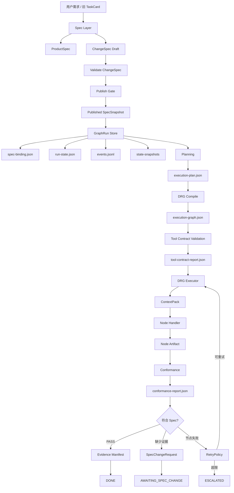
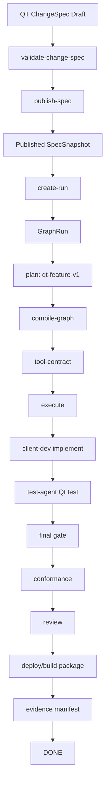

# SpecGraph 驱动的软件开发交付系统架构说明书
SpecGraph 是一个以 Published SpecSnapshot 为合同、以 GraphRun/DRG 为执行骨架、以 Evidence/Conformance 为交付证明的多 Agent 软件工厂运行时。
> 版本：v1.0  
> 日期：2026-08-24  
> 范围：当前 Loop Engineer GraphFlow Runtime 已实现架构，以及下一阶段真实 Handler / 沙箱接入边界  
> 说明：本文将参考文档中的优化目标与当前代码实现区分开来。参考文档用于指导架构方向；本文以当前仓库内 `scheduler/`、`.loop/`、`specs/` 运行时设计为准。

---

## 1. 系统定位

当前系统是一个基于 Spec 驱动的 GraphFlow 全链路交付开发框架。它的目标不是让 Agent 随机推进任务，而是把一次软件变更拆成清晰、可验证、可追溯的交付流水线：

```text
用户需求
  -> ChangeSpec / ProductSpec
  -> Published SpecSnapshot
  -> GraphRun
  -> ExecutionPlan
  -> ExecutionGraph / DRG
  -> ToolContract / ContextPack
  -> Handler 执行
  -> Artifact / Event / StateSnapshot
  -> ConformanceReport
  -> EvidenceManifest
  -> DONE / RETRY / ESCALATED / AWAITING_SPEC_CHANGE
```

一句话定义：

```text
Spec Layer 是合同层，GraphFlow Layer 是执行层，Handler Layer 是专业能力层，Evidence Layer 是交付证明层。
```

系统的核心变化是：

- Spec 不再只是一次性任务描述，而是独立的、可发布、可版本化的规格资产。
- GraphFlow 不再消费草稿需求，而是绑定不可变的 Published SpecSnapshot。
- 每个 GraphRun 固定绑定一个 SpecSnapshot 版本，运行中不能静默切换规格。
- 执行过程中发现规格缺失、冲突或不可证明时，系统生成 SpecChangeRequest，而不是直接修改已发布规格。
- task card 保留为旧系统兼容输入和人工摘要，不再作为新运行时的机器事实源。

---

## 2. 总体架构图



---

## 3. 分层职责

### 3.1 Spec Layer：规格合同层

Spec Layer 负责回答：

```text
这次变更到底要交付什么？
什么算完成？
什么不在范围内？
产品形态、约束、依赖是什么？
```

核心资产：

| 资产 | 路径 | 作用 |
| --- | --- | --- |
| ProductSpec | `specs/{project}/product-spec.json` | 产品长期事实、技术形态、全局约束 |
| ChangeSpec Draft | `specs/{project}/drafts/*.json` | 一次变更的草案 |
| Published SpecSnapshot | `specs/{project}/published/{spec_id}/v{N}/spec-snapshot.json` | GraphFlow 唯一可绑定的不可变规格 |
| SpecChangeRequest | `.loop/runs/{run_id}/spec-change-request.json` | 执行层向规格层反馈规格问题 |

Spec Layer 负责：

- 校验 ChangeSpec 字段完整性。
- 阻断未解决的 `open_questions`。
- 要求至少一个 Requirement。
- 要求至少一个 Acceptance Criterion。
- 将 ChangeSpec 发布为不可覆盖的 SpecSnapshot。
- 为 SpecSnapshot 计算 `content_hash`。
- 处理 SCR 生成的 revision draft。
- 要求 revision draft 经过审批后才能发布新版本。

Spec Layer 不负责：

- 不调度节点。
- 不决定 Agent 执行顺序。
- 不写代码。
- 不运行测试。
- 不在运行中被 GraphFlow 直接修改。

### 3.2 GraphFlow Layer：执行编排层

GraphFlow Layer 负责回答：

```text
已发布规格应该如何被执行？
哪些节点先跑，哪些节点后跑？
当前运行状态是什么？
失败以后应该重试、升级，还是回到规格层？
```

核心资产：

| 资产 | 路径 | 作用 |
| --- | --- | --- |
| SpecBinding | `.loop/runs/{run_id}/spec-binding.json` | 绑定不可变 SpecSnapshot |
| RunState | `.loop/runs/{run_id}/run-state.json` | 当前运行状态 |
| Event Log | `.loop/runs/{run_id}/events.jsonl` | 运行事件流 |
| StateSnapshot | `.loop/runs/{run_id}/state-snapshots/*.json` | 状态快照 |
| ExecutionPlan | `.loop/runs/{run_id}/execution-plan.json` | 从规格生成的工作计划 |
| ExecutionGraph | `.loop/runs/{run_id}/execution-graph.json` | 可执行 DRG |

GraphFlow Layer 负责：

- 创建 GraphRun。
- 固定绑定 SpecSnapshot。
- 生成 ExecutionPlan。
- 编译 ExecutionGraph。
- 校验 DRG 节点类型、边、DAG、覆盖关系。
- 按依赖顺序执行节点。
- 写事件、状态、artifact 引用。
- 处理重试和下游失效。
- 在规格不一致时进入 `AWAITING_SPEC_CHANGE`。
- 在新 Snapshot 被采纳时创建新 GraphRun，并把旧 Run 标记为 `SUPERSEDED`。

GraphFlow Layer 不负责：

- 不创造需求事实。
- 不绕过 SpecSnapshot 直接执行草稿需求。
- 不把 LLM 生成的任意流程当成可执行图。
- 不允许节点随意改写全局 RunState。

### 3.3 Handler Layer：节点专业能力层

Handler 是节点执行适配器。它负责一个节点的专业动作。

当前已实现的 Handler 能力包括：

- gate 节点：写结构化 gate result。
- test 节点：执行 Acceptance Criteria 中的 `check/expect`。
- final gate：执行最终验收检查。
- review 节点：写确定性 Review evidence。
- deploy 节点：写本地确定性 Deploy evidence。
- conformance 节点：生成 ConformanceReport。
- 默认节点：写确定性节点结果 artifact。

未来真实 Handler 会替换或扩展这些确定性 Handler，例如：

- WebTestHandler：执行 `npm test`、`npm run build`。
- QtBuildHandler：执行 `cmake -S ... -B ...` 与 `cmake --build ...`。
- QtTestHandler：执行 `ctest --test-dir ...`。
- ReviewAgentHandler：产出真实 Review 结论。
- DevOpsHandler：产出真实部署、打包或发布证据。

Handler 的边界：

```text
Executor 负责调度和状态；
Handler 负责专业执行和产物；
Handler 不能反向接管 GraphFlow。
```

### 3.4 Tool Contract Layer：权限契约层

Tool Contract 负责回答：

```text
这个节点由哪个 Agent 执行？
允许使用哪些工具？
允许读取哪些路径？
允许写入哪些路径？
必须产出哪些 artifact 类型？
```

示例：

```json
{
  "agent": "test-agent",
  "node_types": ["test"],
  "allowed_tools": ["read_json", "shell_test", "write_json"],
  "read_paths": ["specs/**", ".loop/runs/{run_id}/**", "projects/**", "shared/**"],
  "write_paths": [".loop/runs/{run_id}/artifacts/**"],
  "artifact_types": ["test-result"]
}
```

当前系统已实现：

- 执行前生成 `tool-contract-report.json`。
- 校验节点 Agent 是否存在 contract。
- 校验 Agent 是否允许执行当前 node type。
- 校验 Agent 是否允许产出节点要求的 artifact type。
- Handler 成功返回后，校验 artifact 类型、路径、存在性和写入边界。

当前尚未完全实现：

- Tool Contract 还没有变成操作系统级或进程级真实沙箱。
- 也就是说，当前是“契约校验 + 输出边界校验”，后续需要接入真实执行沙箱，限制 Handler 在运行过程中实际可读、可写、可执行的范围。

### 3.5 Evidence Layer：证据与符合性层

Evidence Layer 负责回答：

```text
系统为什么可以认为这次交付完成？
每个 Requirement 是否有实现证据？
每个 Acceptance Criteria 是否有验证证据？
证据文件是否存在、可索引、可哈希？
```

核心资产：

| 资产 | 路径 | 作用 |
| --- | --- | --- |
| Node Artifact | `.loop/runs/{run_id}/artifacts/*.json` | 节点执行证据 |
| ConformanceReport | `.loop/runs/{run_id}/conformance-report.json` | 需求与证据映射 |
| EvidenceManifest | `.loop/runs/{run_id}/evidence-manifest.json` | 最终证据索引和 hash |

符合 Spec 的当前判断标准：

```text
所有 Requirement 都有 implementation evidence
+
所有 Acceptance Criteria 都有 test/gate evidence
+
可执行 check/expect 通过
+
EvidenceManifest 能索引必要证据
=
符合 Spec
```

---

## 4. 核心领域模型

### 4.1 ProductSpec

ProductSpec 是产品长期事实。它描述一个项目长期稳定的信息，例如：

- 产品类型。
- 目标用户。
- 核心工作流。
- 全局约束。
- 术语表。
- 技术栈倾向。

它不会直接触发一次 GraphRun，但会在发布 Snapshot 时参与合并约束。

### 4.2 ChangeSpec

ChangeSpec 是一次变更草案。它描述：

- `intent`：为什么要做。
- `scope.in`：本次包含什么。
- `scope.out`：本次不包含什么。
- `requirements`：要实现的需求。
- `acceptance_criteria`：验收标准。
- `constraints`：约束。
- `dependencies`：依赖。
- `assumptions`：假设。
- `open_questions`：未解决问题。
- `product_shape`：产品形态。
- `source_refs`：来源引用。

ChangeSpec 发布前必须满足：

- 关键字段存在。
- `open_questions` 为空。
- 至少一个 requirement。
- 至少一个 acceptance criterion。

### 4.3 Published SpecSnapshot

Published SpecSnapshot 是 GraphFlow 的机器合同。

它具备：

- `schema_version`
- `spec_id`
- `version`
- `status=PUBLISHED`
- `published_at`
- `content_hash`
- `project`
- `requirements`
- `acceptance_criteria`
- `constraints`
- `dependencies`
- `product_shape`

关键规则：

```text
GraphRun 只能绑定 Published SpecSnapshot。
Snapshot 发布后不可覆盖。
GraphRun 创建后不能静默换绑 Snapshot。
新规格版本需要新 GraphRun 接续。
```

### 4.4 SpecBinding

SpecBinding 存储在：

```text
.loop/runs/{run_id}/spec-binding.json
```

它记录：

- `spec_id`
- `version`
- `content_hash`
- `snapshot_uri`

作用：

- 保证当前 Run 明确绑定哪个规格版本。
- 防止执行过程中规格漂移。
- 为 Conformance 和 Evidence 提供追溯锚点。

### 4.5 RunState

RunState 存储在：

```text
.loop/runs/{run_id}/run-state.json
```

它记录：

- `run_id`
- `status`
- `bound_spec`
- `current_nodes`
- `completed_nodes`
- `failed_nodes`
- `blocked_nodes`
- `artifact_refs`
- `retry_count`
- `last_error`

典型状态：

| 状态 | 含义 |
| --- | --- |
| BOUND | 已绑定规格，尚未正式执行 |
| RUNNING | 正在执行 DRG |
| DONE | 完成且证据闭环 |
| AWAITING_SPEC_CHANGE | 发现规格问题，需要回到 Spec Layer |
| ESCALATED | 重试耗尽或无法自动处理 |
| SUPERSEDED | 已被新版本 Snapshot 对应的新 Run 接续 |

### 4.6 ExecutionPlan

ExecutionPlan 存储在：

```text
.loop/runs/{run_id}/execution-plan.json
```

它从 SpecSnapshot 生成，负责把 requirements 拆成 work packages。

当前支持模板：

| 模板 | 触发条件 | 实现 Agent |
| --- | --- | --- |
| `web-feature-v1` | 默认 Web 项目 | `frontend-dev` |
| `qt-feature-v1` | project / product_type / platform 包含 `qt` 或 `pc-client` | `client-dev` |

ExecutionPlan 负责：

- 选择模板。
- 生成 work packages。
- 建立 requirement coverage。
- 建立 acceptance coverage。
- 收集 environment requirements。

### 4.7 ExecutionGraph / DRG

ExecutionGraph 存储在：

```text
.loop/runs/{run_id}/execution-graph.json
```

它是可执行的 DRG，也就是实际调度图。

当前 mandatory governance nodes：

```text
spec_binding_node
planning_node
plan_gate_node
architecture_impact_node
architecture_gate_node
drg_compile_node
implementation_drg_node
final_gate_node
conformance_node
delivery_review_node
deploy_node
done_node
```

DRG 校验规则：

- 节点 ID 不重复。
- 必须包含所有治理节点。
- 节点类型必须注册。
- 边必须引用已知节点。
- 图必须是 DAG。
- Requirement 必须覆盖到 implementation 节点。
- Acceptance Criteria 必须覆盖到 test 节点。
- `content_hash` 必须匹配。

### 4.8 Artifact

Artifact 是节点完成的证据文件。

默认路径：

```text
.loop/runs/{run_id}/artifacts/{node_id}.json
```

Artifact 引用会写入 RunState：

```json
{
  "type": "test-result",
  "path": ".loop/runs/run-001/artifacts/wp-r1_test.json",
  "description": "test evidence for wp-r1_test"
}
```

### 4.9 Event

事件日志存储在：

```text
.loop/runs/{run_id}/events.jsonl
```

常见事件：

- `run_created`
- `spec_bound`
- `plan_generated`
- `drg_compiled`
- `tool_contract_validated`
- `agent_context_prepared`
- `node_started`
- `node_completed`
- `artifact_written`
- `node_failed`
- `node_retry_scheduled`
- `node_invalidated`
- `spec_change_requested`
- `evidence_manifest_written`
- `run_escalated`
- `run_superseded`
- `run_supersedes`
- `run_done`

Event Log 的作用：

- 记录不可变执行轨迹。
- 支持审计和回放。
- 避免只依赖单个状态文件判断历史。

### 4.10 ContextPack

ContextPack 存储在：

```text
.loop/runs/{run_id}/context-packs/{node_id}.json
```

它是交给 Handler / Agent 的输入信封，包含：

- 当前 node payload。
- bound spec。
- tool contract。
- spec snapshot 引用。
- run state 引用。
- execution plan 引用。
- execution graph 引用。
- completed artifacts。
- dependency artifacts。

作用：

```text
Handler 不需要自己到处猜上下文；
Executor 在节点启动前把上下文整理好。
```

### 4.11 ConformanceReport

ConformanceReport 存储在：

```text
.loop/runs/{run_id}/conformance-report.json
```

它判断：

- 每个 Requirement 是否有实现证据。
- 每个 Acceptance Criteria 是否有测试证据。
- 整体是否 PASS。

结果：

| 结果 | 含义 |
| --- | --- |
| PASS | Requirement 和 Acceptance 都有证据覆盖 |
| UNVERIFIED | 缺少必要证据 |

### 4.12 EvidenceManifest

EvidenceManifest 存储在：

```text
.loop/runs/{run_id}/evidence-manifest.json
```

它索引：

- `spec-binding.json`
- `run-state.json`
- `execution-plan.json`
- `execution-graph.json`
- `tool-contract-report.json`
- `conformance-report.json`
- node artifacts

每个证据条目包含：

- path
- type
- description
- sha256
- size_bytes

EvidenceManifest 是 DONE 前的最终证据清单。

### 4.13 SpecChangeRequest

SpecChangeRequest 存储在：

```text
.loop/runs/{run_id}/spec-change-request.json
```

触发条件：

- Conformance 发现 requirement 没有证据。
- Acceptance Criteria 没有测试证据。
- Handler 明确返回 `spec_change`。
- 规格与实现现实冲突。

SCR 作用：

- 把问题反馈给 Spec Layer。
- 生成 revision ChangeSpec draft。
- 审批后发布新 SpecSnapshot。
- 新 Snapshot 通过 `supersede-run` 创建新 GraphRun 接续。

### 4.14 RetryPolicy

RetryPolicy 负责节点失败后的自动处理。

支持：

- 默认重试次数。
- 按 node id 限制。
- 按 node type 限制。
- 按 failure reason 限制。
- 限定哪些 node type 可重试。

优先级：

```text
node_id -> failure reason substring -> node_type -> default_max_retries
```

失败后：

```text
可重试 -> reset-node -> 下游节点失效 -> 重新执行
不可重试或超限 -> ESCALATED
```

---

## 5. 全链路流程详解

### 5.1 阶段 0：需求进入系统

输入有两条路径：

```text
推荐路径：用户需求 -> ChangeSpec Draft
兼容路径：旧 TaskCard -> legacy-task-to-change-spec -> ChangeSpec Draft
```

旧 TaskCard 迁移时会读取：

- frontmatter。
- 标题。
- `## Goal`。
- `## Done` 中的结构化验收项。
- dependencies。
- project type。

然后生成：

```text
specs/{project}/drafts/{spec_id}-from-task-card-change-spec.json
```

### 5.2 阶段 1：ChangeSpec 校验

命令：

```bash
python3 -m scheduler.main validate-change-spec specs/{project}/drafts/{spec_id}-change-spec.json
```

负责：

- 检查 required fields。
- 检查 object/list 字段类型。
- 检查 `open_questions` 必须为空。
- 检查 requirements 非空。
- 检查 acceptance_criteria 非空。

失败结果：

```text
ChangeSpec validation failed
```

成功后才允许发布。

### 5.3 阶段 2：发布 Published SpecSnapshot

命令：

```bash
python3 -m scheduler.main publish-spec specs/{project}/drafts/{spec_id}-change-spec.json --version 1
```

负责：

- 从 ChangeSpec 构建 Snapshot。
- 合并 ProductSpec 约束。
- 设置 `status=PUBLISHED`。
- 设置 `published_at`。
- 计算 `content_hash`。
- 写入不可覆盖路径。

输出：

```text
specs/{project}/published/{spec_id}/v1/spec-snapshot.json
```

关键规则：

```text
同一个 spec_id + version 已存在时拒绝覆盖。
revision draft 如果缺少 APPROVED 审批，则拒绝发布。
```

### 5.4 阶段 3：创建 GraphRun 并绑定 Snapshot

命令：

```bash
python3 -m scheduler.main create-run specs/{project}/published/{spec_id}/v1/spec-snapshot.json --run-id run-001
```

负责：

- 校验 Snapshot 是 Published。
- 校验 content hash。
- 创建 `.loop/runs/{run_id}/`。
- 写入 spec-binding。
- 写入初始 run-state。
- 写入事件 `run_created`、`spec_bound`。
- 写入 `state-snapshots/000-created.json`。

输出：

```text
.loop/runs/run-001/spec-binding.json
.loop/runs/run-001/run-state.json
.loop/runs/run-001/events.jsonl
.loop/runs/run-001/state-snapshots/000-created.json
```

### 5.5 阶段 4：生成 ExecutionPlan

命令：

```bash
python3 -m scheduler.main plan run-001
```

负责：

- 读取 RunState 中的 bound spec。
- 加载 SpecSnapshot。
- 根据产品类型选择模板。
- 将 requirements 映射为 work packages。
- 将 acceptance criteria 映射到 test coverage。
- 写入 `execution-plan.json`。
- 写入事件 `plan_generated`。

模板选择：

```text
包含 qt / pc-client -> qt-feature-v1 -> client-dev
其他默认 -> web-feature-v1 -> frontend-dev
```

### 5.6 阶段 5：编译 ExecutionGraph / DRG

命令：

```bash
python3 -m scheduler.main compile-graph run-001
```

负责：

- 读取 execution-plan。
- 生成固定治理节点。
- 为每个 work package 生成 implement/test 节点。
- 连接节点依赖。
- 校验 DAG。
- 校验 requirement 和 acceptance coverage。
- 写入 `execution-graph.json`。
- 写入事件 `drg_compiled`。

核心链路：

```text
spec_binding_node
  -> planning_node
  -> plan_gate_node
  -> architecture_impact_node
  -> architecture_gate_node
  -> drg_compile_node
  -> implementation_drg_node
  -> wp-*_implement
  -> wp-*_test
  -> final_gate_node
  -> conformance_node
  -> delivery_review_node
  -> deploy_node
  -> done_node
```

### 5.7 阶段 6：Tool Contract 校验

命令：

```bash
python3 -m scheduler.main tool-contract run-001
```

负责：

- 检查每个 node 的 agent 是否有 contract。
- 检查 agent 是否允许执行当前 node type。
- 检查 required artifact type 是否在 contract 允许范围内。
- 渲染 read/write path。
- 写入 `tool-contract-report.json`。
- 写入事件 `tool_contract_validated`。

失败时：

```text
Executor 会拒绝执行，RunState 进入 INVALID_TOOL_CONTRACT。
```

### 5.8 阶段 7：执行 DRG

命令：

```bash
python3 -m scheduler.main execute run-001
```

Executor 负责：

- 读取 execution-graph。
- 读取 run-state。
- 找出所有依赖已完成的 ready nodes。
- 启动节点。
- 写入 `node_started`。
- 生成 ContextPack。
- 调用对应 Handler。
- 校验 Handler 返回 artifact。
- 写入 artifact ref。
- 推进 RunState。
- 写入 state snapshot。
- 写入 `node_completed`。

执行循环：

```text
while 存在 ready node:
  准备 context pack
  调用 handler
  如果成功：记录 artifact，完成节点
  如果失败：进入 RetryPolicy
  如果 spec_change：进入 AWAITING_SPEC_CHANGE
  如果达到 max_steps：暂停，保持 RUNNING
```

### 5.9 阶段 8：节点 Handler 执行

当前系统中的 Handler 类型：

| 节点类型 | 当前行为 | 后续真实行为 |
| --- | --- | --- |
| governance | 写确定性运行证据 | 保持轻量治理或调用 Orchestrator |
| plan_gate | 写 plan gate 证据 | 校验计划质量和 coverage |
| architecture | 写架构影响证据 | 调用 ArchitectAgent |
| compiler | 写 DRG compile 证据 | 保持确定性 |
| implementation | 写实现 evidence | 调用真实 DevAgent 修改代码 |
| test | 执行 acceptance check/expect | 调用 Web/Qt 测试命令 |
| gate | 执行 gate check/expect | 强化验收和环境检查 |
| review | 写 APPROVE review | 调用 ReviewAgent |
| deploy | 写 local deploy evidence | 调用真实 build/deploy |
| conformance | 生成 conformance report | 保持确定性 |

### 5.10 阶段 9：Gate 与测试检查

Acceptance Criteria 可以包含：

```json
{
  "id": "acc-001",
  "summary": "保存配置后文件被更新",
  "check": "ctest --test-dir projects/pc-client/build -R SettingsSaveTest",
  "expect": "100% tests passed"
}
```

当前执行逻辑：

- `test` 节点执行与自己绑定的 acceptance checks。
- `final_gate_node` 执行全部 acceptance checks。
- `check` 命令由 gate runner 执行。
- `expect` 用于判断 stdout / exit code 是否符合预期。
- 失败进入 RetryPolicy。

### 5.11 阶段 10：Conformance 判断

`conformance_node` 生成：

```text
.loop/runs/{run_id}/conformance-report.json
```

判断：

- Requirement 是否有 implementation artifact。
- Acceptance Criteria 是否有 test artifact。
- 所有映射是否满足 ExecutionGraph coverage。

如果全部满足：

```text
overall = PASS
```

如果缺少证据：

```text
overall = UNVERIFIED
```

UNVERIFIED 会触发 SpecChangeRequest 或阻断 DONE。

### 5.12 阶段 11：EvidenceManifest 收口

DONE 前生成：

```text
.loop/runs/{run_id}/evidence-manifest.json
```

负责：

- 索引所有 run-level 文件。
- 索引所有 node artifacts。
- 计算 sha256。
- 记录文件大小。
- 确认证据文件存在。

如果 EvidenceManifest 发现缺失 artifact：

```text
Run 不允许进入 DONE。
```

### 5.13 阶段 12：完成、重试、升级、规格变更

最终分支：

| 分支 | 触发条件 | 系统动作 |
| --- | --- | --- |
| DONE | 所有节点完成，Conformance PASS，EvidenceManifest 完整 | 写 `run_done` |
| RETRY | 节点失败且未超过重试上限 | reset node，下游失效，重新 RUNNING |
| ESCALATED | 重试耗尽或不可自动处理 | 写 `run_escalated` |
| AWAITING_SPEC_CHANGE | 规格缺口、规格冲突、证据无法证明 | 写 SCR，等待规格层修订 |

### 5.14 阶段 13：规格修订与新 Run 接续

如果产生 SCR：

```bash
python3 -m scheduler.main revise-spec-from-scr .loop/runs/run-001/spec-change-request.json specs/{project}/published/{spec_id}/v1/spec-snapshot.json
```

生成 revision ChangeSpec draft。

审批：

```bash
python3 -m scheduler.main approve-revision-spec specs/{project}/drafts/{spec_id}-v2-from-run-001-change-spec.json --approved-by spec-owner
```

发布 v2：

```bash
python3 -m scheduler.main publish-spec specs/{project}/drafts/{spec_id}-v2-from-run-001-change-spec.json --version 2
```

接续新 Run：

```bash
python3 -m scheduler.main supersede-run run-001 specs/{project}/published/{spec_id}/v2/spec-snapshot.json --new-run-id run-002
```

规则：

```text
旧 run-001 标记 SUPERSEDED。
旧 run-001 的 spec-binding 不改。
新 run-002 绑定 v2 Snapshot。
```

---

## 6. DRG 节点职责说明

| 节点 | 类型 | 执行者 | 职责 | 主要输入 | 主要输出 |
| --- | --- | --- | --- | --- | --- |
| `spec_binding_node` | governance | gate-auto | 确认当前 Run 已绑定 Published Snapshot | spec-binding | governance artifact |
| `planning_node` | governance | orchestrator-llm | 表示计划阶段进入运行链路 | SpecSnapshot | governance artifact |
| `plan_gate_node` | plan_gate | gate-auto | 校验计划阶段通过 | ExecutionPlan | gate artifact |
| `architecture_impact_node` | architecture | architect-agent | 分析架构影响 | SpecSnapshot, plan | architecture artifact |
| `architecture_gate_node` | gate | gate-auto | 架构闸门 | architecture artifact | gate artifact |
| `drg_compile_node` | compiler | gate-auto | 确认 DRG 编译结果可执行 | execution-graph | compiler artifact |
| `implementation_drg_node` | governance | orchestrator-llm | 进入实现子图 | execution-graph | governance artifact |
| `wp-*_implement` | implementation | frontend-dev / client-dev | 实现某个 requirement | requirement, context-pack | implementation artifact |
| `wp-*_test` | test | test-agent | 验证 acceptance criteria | acceptance checks | test-result artifact |
| `final_gate_node` | gate | gate-auto | 全量最终验收 | acceptance checks | gate-result artifact |
| `conformance_node` | conformance | gate-auto | Requirement / Acceptance 证据映射 | graph, artifacts | conformance-report |
| `delivery_review_node` | review | review-agent | 交付评审 | evidence, conformance | review artifact |
| `deploy_node` | deploy | devops-agent | 构建、部署或交付打包 | artifacts, review | deploy artifact |
| `done_node` | governance | gate-auto | 运行完成收口 | evidence manifest | done artifact |

---

## 7. QT 项目运转链路

当项目是 QT / PC 客户端时，SpecSnapshot 中通常会包含：

```json
{
  "project": "pc-client",
  "product_shape": {
    "product_type": "qt",
    "platform": "desktop"
  }
}
```

ExecutionPlan 会选择：

```text
template_id = qt-feature-v1
implementation agent = client-dev
```

QT 任务的标准链路：



当前 QT 支持状态：

- 已能识别 QT / PC Client 并选择 `qt-feature-v1`。
- 已能把 requirement 编译为 `client-dev` 实现节点。
- 已能把 acceptance criteria 编译为 test 节点。
- 已能执行 `check/expect` 类型的验收命令。
- 尚未内置真实 QtBuildHandler / QtTestHandler / QtDeployHandler。

推荐下一阶段 QT Handler：

| Handler | 职责 |
| --- | --- |
| QtEnvHandler | 检查 CMake、Qt、编译器路径 |
| QtBuildHandler | 执行 CMake configure/build |
| QtTestHandler | 执行 ctest |
| QtDeployHandler | 收集可执行文件、bundle、构建日志 |

---

## 8. Web 项目运转链路

当项目未匹配 QT 时，默认选择：

```text
template_id = web-feature-v1
implementation agent = frontend-dev
```

Web 项目标准链路与 QT 相同，但 Handler Profile 不同。

推荐真实 Handler：

| Handler | 职责 |
| --- | --- |
| WebInstallHandler | 安装依赖或校验依赖 |
| WebLintHandler | 执行 lint |
| WebTestHandler | 执行 unit/e2e tests |
| WebBuildHandler | 执行 production build |
| WebDeployHandler | 本地预览、容器构建或部署 |

关键点：

```text
GraphFlow 主链路不按项目类型分叉；
差异只进入 ExecutionPlan 模板和 Handler Profile。
```

---

## 9. Tool Contract 与真实沙箱的关系

当前 Tool Contract 是规则层。

它能告诉系统：

```text
某个 Agent 在某类节点里允许做什么。
```

真实沙箱是执行层。

它要做到：

```text
某个 Agent 在运行过程中真的只能做被允许的事。
```

当前已实现：

- contract 定义。
- contract 校验。
- artifact 输出边界校验。
- context-pack 注入 contract。

后续需要实现：

- 基于 contract 启动受限执行环境。
- 限制文件读写范围。
- 限制命令白名单。
- 限制环境变量。
- 限制网络访问。
- 记录真实命令日志和退出码。

关系可以概括为：

```text
ToolContract 是门禁名单；
真实沙箱是门和锁。
```

---

## 10. 命令行操作闭环

### 10.1 推荐完整路径

```bash
python3 -m scheduler.main validate-change-spec specs/{project}/drafts/{spec_id}-change-spec.json
python3 -m scheduler.main publish-spec specs/{project}/drafts/{spec_id}-change-spec.json --version 1
python3 -m scheduler.main create-run specs/{project}/published/{spec_id}/v1/spec-snapshot.json --run-id run-001
python3 -m scheduler.main plan run-001
python3 -m scheduler.main compile-graph run-001
python3 -m scheduler.main tool-contract run-001
python3 -m scheduler.main execute run-001
python3 -m scheduler.main evidence run-001
```

### 10.2 一键 smoke-flow

```bash
python3 -m scheduler.main smoke-flow specs/{project}/drafts/{spec_id}-change-spec.json --version 1 --run-id run-001
```

适合验证：

- ChangeSpec 是否能发布。
- Snapshot 是否能绑定。
- Plan 是否能生成。
- DRG 是否可编译。
- ToolContract 是否通过。
- Executor 是否能跑完整链路。
- EvidenceManifest 是否生成。

### 10.3 旧 TaskCard 迁移路径

```bash
python3 -m scheduler.main legacy-task-to-change-spec .loop/active/{project}/task-001-demo.md
```

然后继续：

```bash
python3 -m scheduler.main publish-spec specs/{project}/drafts/task-001-from-task-card-change-spec.json --version 1
```

---

## 11. 当前已实现能力清单

当前已经完成：

- ChangeSpec 校验。
- ProductSpec 基础校验。
- Published SpecSnapshot 发布。
- Snapshot content hash 校验。
- GraphRun 创建。
- SpecBinding 不可变绑定。
- RunState 管理。
- Run Event Log。
- State Snapshots。
- ExecutionPlan 生成。
- Web / QT 模板选择。
- ExecutionGraph / DRG 编译。
- Mandatory Governance Nodes 校验。
- DAG 校验。
- Requirement / Acceptance coverage 校验。
- ToolContract 定义与校验。
- Handler 输出 artifact contract 校验。
- ContextPack 生成。
- DRGExecutor 依赖顺序执行。
- test / gate check-expect 执行。
- ConformanceReport。
- EvidenceManifest。
- SpecChangeRequest。
- SCR -> revision ChangeSpec draft。
- revision approval gate。
- Supersede old run。
- RetryPolicy。
- reset-node 下游失效传播。
- legacy task card -> ChangeSpec draft。
- smoke-flow 端到端本地闭环。

---

## 12. 当前边界与下一阶段

当前系统已经具备完整的架构运行骨架，但仍处于“确定性运行时 + 可插拔 Handler 接口”阶段。

当前边界：

- implementation 节点尚未真实调用开发 Agent 修改代码。
- review 节点尚未真实调用 ReviewAgent 进行语义评审。
- deploy 节点尚未真实执行构建、打包、部署。
- ToolContract 尚未接入真实执行沙箱。
- Web / QT 的 build/test/deploy handler profile 尚未完全落地。

下一阶段建议：

1. 新增 Handler Registry。
2. 定义 Handler Profile：Web / QT / Generic。
3. 优先接入 QtTestHandler 或 WebTestHandler。
4. 让 Handler 从 ContextPack 读取 contract、project_root、commands。
5. 将真实命令输出写入标准 artifact。
6. 将 ToolContract 和真实执行沙箱打通。
7. 用一个真实小项目跑完整案例，反向修正模板、artifact 类型和 gate 规则。

---

## 13. 架构闭环总结

这个系统的闭环不是“Agent 做完就算完成”，而是：

```text
规格先发布
运行再绑定
计划可校验
图可编译
节点受契约约束
执行有事件
产物有 artifact
需求有 conformance
交付有 evidence
失败有 retry
规格问题有 SCR
新规格有新 Run
```

因此，系统最终形成的是一个可审计、可重试、可修订、可证明的软件交付流水线。

