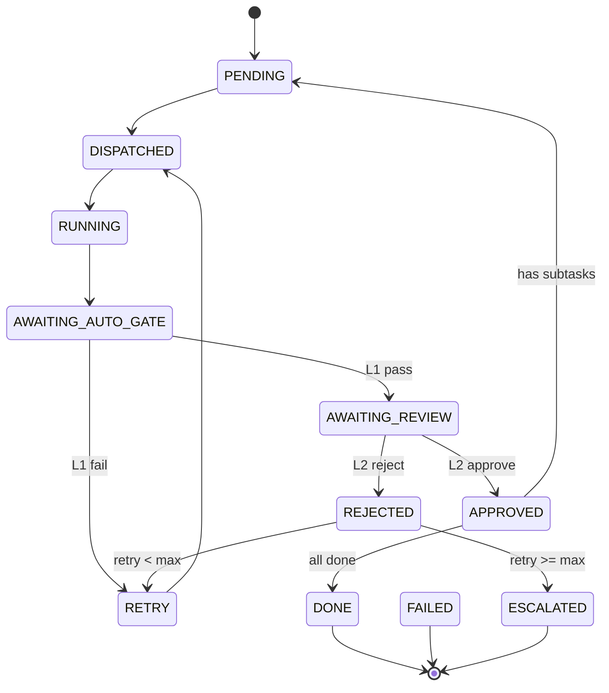

# 三层融合架构详细设计

> SDD（规约驱动开发）+ Multi-Agent（多智能体协作）+ Loop Engineering（自主循环）三层融合，面向个人开发者 + AI Loop 的软件开发工厂。

## 1. 架构总览

```
┌─────────────────────────────────────────────────────────┐
│                    用户 / 开发者                         │
│              提交需求 → 审核 → 验收                      │
├─────────────────────────────────────────────────────────┤
│                                                         │
│  ┌─────────────────────────────────────────────────┐   │
│  │          Layer 1: Spec 规约层                   │   │
│  │                                                 │   │
│  │  .loop/context.md    项目全局上下文             │   │
│  │  .loop/loop.md        Loop 配置（预算/终止）     │   │
│  │  .loop/active/*.md    任务卡（Goal/Done/...）    │   │
│  │  .loop/done/*.md      归档的已完成任务           │   │
│  └──────────────────────┬──────────────────────────┘   │
│                         │ 规约即输入                    │
│  ┌──────────────────────▼──────────────────────────┐   │
│  │          Layer 2: Loop 驱动层                    │   │
│  │                                                 │   │
│  │  Loop Engine                                    │   │
│  │  ├── 读取任务卡 → 解析 Done 条件                │   │
│  │  ├── 分配给 Agent → 收集结果                    │   │
│  │  ├── 检查 Done → 未完成则继续循环                │   │
│  │  ├── 预算控制（token / 时间 / 轮次）            │   │
│  │  └── 收敛判断 → 全部 Done 则归档                │   │
│  └──────────────────────┬──────────────────────────┘   │
│                         │ 调度指令                      │
│  ┌──────────────────────▼──────────────────────────┐   │
│  │          Layer 3: Multi-Agent 执行层            │   │
│  │                                                 │   │
│  │  Orchestrator ──→ SpecAgent                     │   │
│  │       │              │                          │   │
│  │       ▼              ▼                          │   │
│  │  ArchitectAgent ─┬→ BackendDev                  │   │
│  │                  └→ UIDesignAgent → FrontendDev │   │
│  │       │                    │          │         │   │
│  │       ▼                    ▼          ▼         │   │
│  │  TestAgent ←────── 集成测试 ←──── 代码          │   │
│  │       │                                         │   │
│  │       ▼                                         │   │
│  │  ReviewAgent ──→ Approve / Reject               │   │
│  │       │                                         │   │
│  │       ▼                                         │   │
│  │  DevOpsAgent ──→ 构建 + 部署                    │   │
│  └─────────────────────────────────────────────────┘   │
│                                                         │
├─────────────────────────────────────────────────────────┤
│              工程基础设施                                │
│  Git Worktree │ 共享黑板 │ API 契约 │ CI/CD            │
└─────────────────────────────────────────────────────────┘
```

## 2. Layer 1: Spec 规约层

### 2.1 设计原则

| 原则 | 说明 |
|------|------|
| **单一事实来源** | 每个任务一个 `.md` 文件，不存在重复的规约副本 |
| **可验证验收** | Done 条件必须是可执行的声明式 check 命令 + expect 预期 |
| **结构化状态** | 任务卡含 frontmatter（status/assigned_to/round/retry_count/artifacts），调度器通过 status 驱动状态机 |
| **可追溯归档** | 完成的任务从 `active/` 移到 `done/`，保留历史 |

### 2.2 任务卡模板（v2.0）

详见 `.loop/active/README.md`。任务卡升级为带 frontmatter 的结构化文档：

```yaml
---
id: task-NNN
status: PENDING              # 状态机驱动（见 .loop/state-machine.md）
assigned_to: null             # 当前负责的 Agent
round: 0                      # 第几轮循环
retry_count: 0                # 重试次数
dependencies: []              # 依赖的其他任务 ID
artifacts: []                 # 产物引用列表（路径，非内容）
---

## Done（声明式验收标准）
- id: d1
  check: "[可执行的 shell 命令]"
  expect: "[预期结果，支持 精确/正则/包含/数值/退出码 模式]"
  status: pending              # pending|passed|failed
```

Done 项不再是自由文本 checkbox，而是结构化的可执行检查项，由 Gate-Auto（L1 自动闸门）执行。

### 2.3 Loop 配置（`.loop/loop.md`）

| 配置项 | 默认值 | 说明 |
|--------|--------|------|
| `max_rounds` | 10 | 单任务最大循环轮次 |
| `max_tokens` | 500000 | 单任务最大 token 消耗 |
| `max_time_minutes` | 30 | 单任务最大执行时间 |
| `convergence_check` | all_done | 收敛判断策略（all_done / threshold） |
| `done_threshold` | 1.0 | Done 条件完成比例阈值 |
| `retry_on_fail` | 3 | Agent 失败重试次数 |
| `escalate_after_retry` | true | 重试耗尽后升级到人类 |

## 3. Layer 2: Loop 驱动层

### 3.1 Loop 执行循环

```
┌──────────────────────────────────────────┐
│  1. 读取 .loop/active/ 下的任务卡          │
│     解析 Goal + Done 条件                 │
├──────────────────────────────────────────┤
│  2. 分配任务给 Orchestrator               │
│     Orchestrator 分解子任务               │
│     分配给具体 Agent                       │
├──────────────────────────────────────────┤
│  3. Agent 执行                            │
│     各 Agent 在独立上下文中工作            │
│     结果写入 shared/blackboard.md         │
├──────────────────────────────────────────┤
│  4. 收集结果 + 更新 Progress              │
│     勾选已完成的 Done 项                  │
├──────────────────────────────────────────┤
│  5. 收敛检查                              │
│     ├─ 全部 Done → 归档到 done/ → 结束   │
│     ├─ 预算耗尽 → 升级到人类              │
│     └─ 未完成 → 回到步骤 2（继续循环）    │
└──────────────────────────────────────────┘
```

### 3.2 预算控制策略

```yaml
token_budget:
  orchestrator: 50000    # 编排器预算
  spec_agent: 30000      # 规约 Agent 预算
  architect: 40000       # 架构 Agent 预算
  dev_agent: 100000      # 开发 Agent 预算（最大）
  test_agent: 30000      # 测试 Agent 预算
  review_agent: 20000   # 评审 Agent 预算
  devops_agent: 20000   # DevOps Agent 预算
  total_max: 500000     # 单任务总预算上限

time_budget:
  per_agent: 600        # 单 Agent 最大执行时间（秒）
  total_max: 1800       # 单任务最大总时间（秒）

round_budget:
  max_rounds: 10        # 最大循环轮次
  escalate_after: 10    # 超过则升级
```

### 3.3 收敛与终止

| 终止条件 | 触发动作 |
|---------|---------|
| 所有 Done 条件勾选 | 归档任务到 `done/`，标记成功 |
| 达到 max_rounds | 升级到人类审核，附带当前进度 |
| 达到 max_tokens | 升级到人类审核，附带消耗报告 |
| 达到 max_time | 强制终止，升级到人类 |
| Agent 连续失败 > retry 上限 | 升级到人类，附带错误日志 |

## 4. Layer 3: Multi-Agent 执行层

### 4.1 Agent 协作拓扑

采用**星型 + 层级委派**混合拓扑：

```
              Orchestrator（调度器 / 中枢）
                     │
                     ▼
                SpecAgent
                     │
                     ▼
              ArchitectAgent
                     │
          ┌──────────┴──────────┐
          ▼                     ▼
    UIDesignAgent         BackendDevAgent
          │                     │
          ▼                     │
    FrontendDevAgent            │
          │                     │
          └──────────┬──────────┘
                     ▼
                 TestAgent
                     │
                     ▼
                ReviewAgent
              (Approve / Reject)
                     │
                     ▼
                DevOpsAgent
```

- **Orchestrator** 是唯一中枢，所有 Agent 不直接通信
- **ArchitectAgent** 委派给 UIDesignAgent 和 BackendDevAgent（并行）
- **UIDesignAgent** 完成后触发 FrontendDevAgent
- **ReviewAgent** 接收所有 Dev Agent 的输出

### 4.2 通信协议

Agent 间通过 `shared/blackboard.md` 传递结构化消息。消息 Schema 详见 `shared/blackboard.md` §1：

```json
{
  "msg_id": "msg-001",
  "timestamp": "2026-08-10T10:00:00Z",
  "from": "scheduler",
  "to": "backend-dev",
  "type": "task_assign",
  "task_id": "task-001",
  "round": 1,
  "artifacts": [
    {"type": "artifact", "path": ".loop/artifacts/{project}/task-001/round-1/architecture.json", "description": "架构决策"}
  ],
  "verdict": null,
  "summary": "分配后端开发任务"
}
```

**核心原则：交接传 artifact 路径引用，不传内容。** 下游 Agent 按需读取。

消息类型：

| 类型 | 方向 | 说明 |
|------|------|------|
| `task_assign` | scheduler → agent | 分配任务 |
| `task_result` | agent → scheduler | 返回执行结果 |
| `review_request` | scheduler → review-agent | 请求评审 |
| `review_result` | review-agent → scheduler | 评审结果（APPROVE/REJECT） |
| `gate_result` | gate-auto → scheduler | L1 闸门结果（PASS/FAIL） |
| `contract_update` | architect → all | API 契约变更通知 |
| `retry` | scheduler → agent | 重试通知 |
| `escalate` | any → human | 升级到人类 |

### 4.3 Git Worktree 隔离方案

```
d:\01Loop-WorkSpace\
├── projects/
│   ├── web-app/              ← WEB 应用主仓库（main 分支）
│   │   ├── backend/
│   │   └── frontend/
│   └── pc-client/            ← QT 客户端主仓库（main 分支）
│       ├── src/
│       ├── CMakeLists.txt
│       └── tests/
└── worktrees/
    ├── backend-task-001/     ← BackendDevAgent 的 Worktree
    │                        （checkout branch: feature/task-001-backend）
    ├── frontend-task-001/    ← FrontendDevAgent 的 Worktree
    │                        （checkout branch: feature/task-001-frontend）
    ├── client-task-001/      ← ClientDevAgent 的 Worktree
    │                        （checkout branch: feature/task-001-client）
    └── test-task-001/        ← TestAgent 的 Worktree
                             （checkout branch: test/task-001）
```

**操作流程**：
1. 调度器为每个子任务创建 Git 分支
2. 对应 Agent 在独立 Worktree 中开发
3. 开发完成提交 PR
4. ReviewAgent 评审
5. Approve 后合并到 main

## 5. 前后端分离 WEB 架构

### 5.1 技术选型建议

| 层 | 技术方案 | 理由 |
|----|---------|------|
| **后端** | Node.js + Fastify / Python + FastAPI | 轻量、生态成熟、AI 友好 |
| **前端** | React + Vite + TypeScript | 主流、类型安全、组件丰富 |
| **数据库** | PostgreSQL + Prisma / SQLAlchemy | 关系型 + ORM，类型安全 |
| **API 契约** | OpenAPI 3.0 + TypeScript 生成 | 契约驱动，前后端类型同步 |
| **测试** | Vitest（前端）+ Pytest/Jest（后端） | 快速、与框架集成好 |
| **部署** | Docker + docker-compose | 环境一致，便于 DevOps |

### 5.1.1 PC-QT 客户端技术选型（二期）

| 层 | 技术方案 | 理由 |
|----|---------|------|
| **框架** | Qt 5.15 LTS（Widget 路线） | 长期支持、桌面生态成熟、遗留项目兼容 |
| **构建** | CMake 3.16+（find_package(Qt5)） | Qt5 官方支持、跨平台、禁用 qmake |
| **语言** | C++17 | 现代 C++ 特性、Qt5 兼容 |
| **UI 描述** | .ui（Qt Designer XML）+ .qrc + .qss | 可视化设计、资源系统、样式表分离 |
| **网络** | QNetworkAccessManager | Qt 原生 HTTP 客户端，复用 WEB 后端 API 契约 |
| **测试** | Qt Test + ctest 驱动 | 与 Qt 集成、CMake 原生支持 |
| **编译器** | MSVC 2019/2022 | Windows 主流、Qt5 官方支持好 |

### 5.2 API 契约管理

`shared/api-contract.md` 是前后端的**单一事实来源**：

```markdown
## User API

### POST /api/users
创建用户

**Request:**
```json
{ "name": "string", "email": "string" }
```

**Response 201:**
```json
{ "id": "number", "name": "string", "email": "string", "created_at": "string" }
```

**Error 400:**
```json
{ "error": "string", "code": "string" }
```
```

**契约同步规则**：
- ArchitectAgent 定义契约
- UIDesignAgent 基于契约设计 UI 规约
- BackendDevAgent 实现契约
- FrontendDevAgent 消费契约 + 消费 UI 设计规约
- 契约变更必须经 ArchitectAgent 审核 + 通知所有相关方

### 5.3 项目目录结构

```
projects/web-app/
├── backend/
│   ├── src/
│   │   ├── routes/         # API 路由
│   │   ├── services/       # 业务逻辑
│   │   ├── models/         # 数据模型
│   │   ├── tests/          # 单元测试
│   │   └── app.ts          # 入口
│   ├── package.json
│   └── tsconfig.json
├── frontend/
│   ├── src/
│   │   ├── pages/          # 页面
│   │   ├── components/     # 组件
│   │   ├── hooks/          # 自定义 Hook
│   │   ├── api/            # API 调用（从契约生成）
│   │   ├── stores/         # 状态管理
│   │   └── App.tsx
│   ├── package.json
│   └── tsconfig.json
├── shared/
│   └── types/              # 从 API 契约生成的类型
├── docker-compose.yml
└── README.md
```

## 6. 可扩展性

### 6.1 扩展到 PC-QT 客户端（二期，已落地支持）

| 层 | 技术方案 |
|----|---------|
| 框架 | Qt 5.15 LTS（Widget 路线） |
| 构建 | CMake 3.16+（find_package(Qt5)，禁用 qmake） |
| 语言 | C++17 |
| UI 描述 | .ui（Qt Designer XML）+ .qrc（资源）+ .qss（样式） |
| 网络 | QNetworkAccessManager（复用 WEB 后端 API 契约） |
| 测试 | Qt Test + ctest |
| 编译器 | MSVC 2019/2022（Windows） |

```
projects/
├── web-app/         ← 已有：WEB 应用
├── pc-client/       ← QT 客户端
│   ├── src/
│   │   ├── main.cpp
│   │   ├── widgets/       ← .ui + .cpp/.h（窗口/对话框）
│   │   ├── models/        ← QStandardItemModel 等
│   │   ├── network/       ← QNetworkAccessManager 封装
│   │   ├── styles/        ← .qss 样式表
│   │   └── resources/     ← .qrc 资源
│   ├── tests/            ← Qt Test 单元测试
│   └── CMakeLists.txt
└── shared/
    └── api-contract.md  ← 跨端共享的 API 契约（单一事实来源）
```

- QT 客户端复用同一套 API 契约（`shared/api-contract.md`）
- 新增 `ClientDevAgent`（C++/Qt5/CMake 专长，见 `agents/client-dev.md`）
- UIDesignAgent 通过 `platform: "qt"` 输出 QT 设计规约（窗口/控件/信号槽/QSS）
- 后端 API 不变，仅客户端实现不同
- ClientDevAgent 与 BackendDevAgent 并行（基于同一契约，互不依赖）

### 6.2 扩展到微信小程序

```
projects/
├── web-app/
├── pc-client/
├── mini-program/     ← 新增：微信小程序
│   ├── pages/
│   ├── components/
│   ├── api/          ← 复用 API 契约
│   └── app.json
└── shared/
    └── api-contract.md
```

- 新增 `MiniProgramDevAgent`
- API 契约保持单一事实来源
- 小程序特殊约束（包大小、API 限制）在 Constraints 中声明

## 7. 实施路线图

| 阶段 | 交付物 | 验收标准 | 状态 |
|------|--------|---------|------|
| Phase 0 | 目录结构 + 模板 | `.loop/` `agents/` `shared/` 就绪 | ✅ 已完成 |
| Phase 1 | 规约层 + Loop 配置 | 任务卡模板可用 | ✅ 已完成 |
| Phase 2 | 核心 Agent 定义 | Orchestrator/Spec/Architect 就绪 | ✅ 已完成 |
| Phase 3 | 开发 Agent | Backend/Frontend Dev Agent 就绪 | ✅ 已完成 |
| Phase 4 | 质量保障 | Test + Review Agent 就绪 | ✅ 已完成 |
| Phase 5 | DevOps | DevOpsAgent 就绪 | ✅ 已完成 |
| Phase 6 | 运行时架构重构 | 调度器+状态机+工具化Agent+闸门+产物外部化 | ✅ 已完成 |
| Phase 7 | 首个 WEB 应用 | 端到端走通一次完整 Loop | ⏳ 待开始 |

---

## 8. 运行时架构

> §1-§7 描述的是逻辑架构（谁负责什么、消息怎么传）。本节描述**物理运行时**：这些 Agent 在现实中怎么被实例化、切换、管理。

### 8.1 运行模式选型

采用**混合模式：确定性 Workflow Engine + 嵌入式 LLM 决策点**。

| 层面 | 实现方式 |
|------|---------|
| 调度器骨架 | 确定性代码（状态机驱动，不允许 LLM 跳转状态） |
| 节点内决策 | LLM（新开独立会话，按需实例化） |
| 状态管理 | 调度器侧（任务卡 frontmatter） |
| 上下文管理 | artifact store（文件系统，传引用不传内容） |
| 质量控制 | 三层闸门（L1 自动 / L2 LLM 评审 / L3 人工） |

**不采用的模式**：
- ~~单会话角色切换~~：上下文窗口爆掉、角色混淆
- ~~多进程常驻~~：基础设施过重，不适合个人开发者
- ~~纯 LLM 调度~~：不可预测、难复现

### 8.2 调度器架构

详见 `agents/orchestrator.md`。调度器包含 6 个组件：

| 组件 | 职责 |
|------|------|
| 状态机引擎 | 读取任务卡 status，决定下一节点；拒绝非法跳转 |
| 闸门执行器 | 执行任务卡 Done 项的声明式 check 命令 |
| Agent 调用器 | 新开 LLM 会话，注入上下文包，收集结构化输出 |
| 产物管理器 | 将 Agent 输出存入 `.loop/artifacts/` |
| 重试/回滚控制器 | 记录 retry_count，回滚到 checkpoint |
| 运行时上下文 | 当前任务卡、round、状态、累计 token |

### 8.3 Agent 实例化机制

Agent 没有"自己的空间"。`agents/*.md` 是**角色定义文件**，每次实例化时注入到新会话的 system prompt。

```
调度器决定调用 Agent B
  │
  ├─ 1. 读取 agents/backend-dev.md          ← Agent 角色定义
  ├─ 2. 读取 .loop/active/{project}/task-xxx.md        ← 任务卡
  ├─ 3. 收集 artifact 路径引用               ← 上游产物（路径，非内容）
  ├─ 4. 读取 agents/_schema.md              ← 输出格式要求
  │
  ├─ 5. 新开 LLM 会话
  │     system_prompt = agents/backend-dev.md 内容
  │     user_message = 任务卡 + artifact 引用 + 输出 Schema
  │
  ├─ 6. Agent 执行（写代码、跑测试）
  │
  ├─ 7. Agent 返回结构化 JSON
  │
  ├─ 8. 校验输出是否符合 Schema
  │     ├─ 符合 → 存入 artifact store → 会话销毁
  │     └─ 不符 → 重试（上限 2 次）
  │
  └─ 9. 调度器继续按状态机走
```

**关键洞察**：LLM 是无状态的白纸，文件系统（artifact store + 任务卡 + blackboard）才是真正的"共享内存"。

### 8.4 状态机

详见 `.loop/state-machine.md`。11 个状态，14 条合法转换：



调度器代码强制执行转换表，LLM 不允许自由跳转。

### 8.5 三层质检

| 层 | 执行者 | 触发时机 | 不通过动作 |
|----|--------|---------|------------|
| **L1 自动闸门** | Gate-Auto（确定性脚本） | Agent 输出产物后 | 直接 RETRY，不进入 L2 |
| **L2 契约评审** | ReviewAgent（LLM） | L1 通过后 | 输出结构化 issues，RETRY 或 REJECTED |
| **L3 人工抽查** | 开发者 | 关键节点 | ESCALATED，等待人工 |

详见 `agents/gate-auto.md` 和 `agents/review-agent.md`。

### 8.6 重试与回滚

- 每次 Agent 输出后，调度器打 Git checkpoint tag：`checkpoint/{task_id}-round-{N}`
- RETRY 时 `git reset` 到上一个 checkpoint，清除当前轮 artifact
- 重试上限：3 次（L1/L2 失败），2 次（Schema 违规/超时）
- 重试耗尽 → ESCALATED

详见 `.loop/loop.md` §3 重试与回滚策略。

### 8.7 并行实现

调度器同时开多个 LLM 会话（每个 Agent 一个独立会话），各自在独立 Git Worktree 中工作。

| 并行组 | Agent | 前置条件 |
|--------|-------|---------|
| 后端 + UI设计 | BackendDevAgent, UIDesignAgent | ArchitectAgent 输出 API 契约后 |
| 前端（后半程） | FrontendDevAgent | UIDesignAgent 输出 ui-design.json 且 UI Review APPROVE 后 |
| 多任务 | 多个独立 task 的 DISPATCHED | 任务间无依赖 |

并行冲突防护：同一文件不允许两个 Agent 同时修改，由调度器在 DISPATCH 前检查文件占用。

---

## 9. Agent 工具化规范

> §4 描述了 Agent 的逻辑协作拓扑。本节定义 Agent 的**物理调用规范**：每个 Agent 是可调用能力，有固定 IO Schema、上下文预算、失败策略。

### 9.1 核心理念

**Agent = 可调用能力，不是常驻角色。**

- 调度器按需新开 LLM 会话，注入 Agent 定义 + 上下文包
- Agent 执行完返回结构化 JSON，会话即销毁
- LLM 无状态，所有重要信息落盘到 artifact store
- 交接传引用不传内容

### 9.2 Agent 清单与调用约定

详见 `agents/README.md`。9 个 Agent + 1 个闸门执行器：

| Agent | 触发状态 | 产物类型 | 并行 |
|-------|---------|---------|------|
| SpecAgent | PENDING | 任务卡 .md | 否 |
| Orchestrator-LLM | PENDING | 分配决策 JSON | 否 |
| ArchitectAgent | DISPATCHED | 架构 JSON + 契约 | 否 |
| BackendDevAgent | DISPATCHED | 代码 diff | 是（与UIDesign） |
| UIDesignAgent | DISPATCHED | UI 设计规约 JSON | 是（与Backend） |
| FrontendDevAgent | DISPATCHED | 代码 diff | 是（后半程与Backend） |
| TestAgent | DISPATCHED | 测试报告 JSON | 否 |
| Gate-Auto | AWAITING_AUTO_GATE | 闸门结果 JSON | 否 |
| ReviewAgent | AWAITING_REVIEW | 评审报告 JSON | 否 |
| DevOpsAgent | PENDING | 部署结果 JSON | 否 |

### 9.3 IO Schema

详见 `agents/_schema.md`。通用输入 Schema（上下文包）和通用输出 Schema（结构化 JSON）统一定义，各 Agent 有专属输出 Schema。

### 9.4 产物外部化

详见 `.loop/artifacts/README.md`。产物存储在 `.loop/artifacts/{task_id}/{round}/` 目录：

- Agent 间交接只传 artifact 路径，不传内容
- 下游 Agent 按需读取文件
- 每个 artifact 必须符合 Schema
- RETRY 时清除当前轮产物，DONE 时保留全部作为历史
