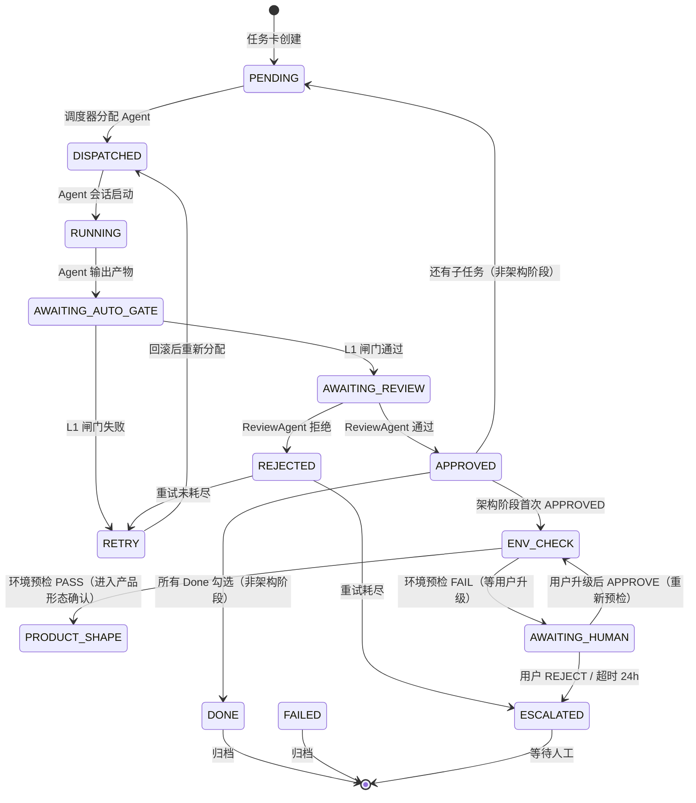
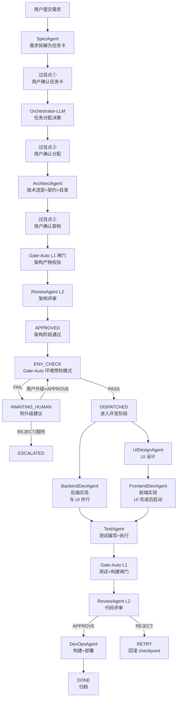
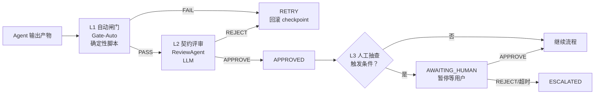
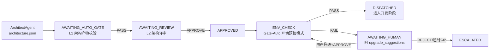

# Multi-Agent 协作模式链路流程

> 本文档总结 Loop-WorkSpace 多 Agent 协作架构的完整链路流程，含状态机驱动、Agent 调度、三层质检、ENV_CHECK 环境预检等机制。
> 用途：新会话快速理解系统链路 / 调度器实施参考 / 故障排查定位。
> 关联文件：`.loop/state-machine.md` / `.loop/loop.md` / `agents/orchestrator.md` / `agents/gate-auto.md`

---

## 1. 架构总览

Loop-WorkSpace 采用 **SDD + Multi-Agent + Loop** 三层融合架构：

| 层 | 职责 | 载体 |
|----|------|------|
| Spec 层 | 锁定目标（任务卡 + Done 项） | `.loop/active/{project}/task-NNN-*.md` |
| Loop 层 | 驱动过程（状态机 + 调度器） | `.loop/state-machine.md` + `.loop/loop.md` |
| Agent 层 | 执行动作（10 个专职 Agent） | `agents/*.md` |

**调度模式**：LLM-as-Orchestrator 渐进硬化（"先软后硬"）
- Layer 0：AI 手动当调度器，零代码，遵守 `orchestrator.md §8.2` 四条铁律
- Layer 1：提取确定性脚本（gate / checkpoint / budget / transition）
- Layer 2：写 `scheduler/main.ts` 串联，收敛到 `orchestrator.md` 目标形态

**混合模式**：骨架硬编码（状态机）+ 节点内 LLM 决策
- 确定性部分：状态转换查表 / L1 闸门执行 shell / 预算守卫计数 / checkpoint git tag / 产物落盘路径 / 环境预检 / 经验沉淀
- LLM 决策部分：需求拆解 / 任务分配 / 架构决策 / UI 设计 / 代码实现 / 测试编写 / 评审 Approve/Reject

**多子任务链路**（Phase 8.1 + 8.2 评审修复）：
- 架构阶段（phase=architecture）：SpecAgent → Orchestrator-LLM → ArchitectAgent → ENV_CHECK，产出全局产物（spec/architecture/env-check）
  - **H-3 修复**：SpecAgent / Orchestrator-LLM 也走完整状态机（DISPATCHED → RUNNING → AWAITING_AUTO_GATE → AWAITING_REVIEW → APPROVED），不再在 PENDING 内连续调用后直接 DISPATCHED 给 architect-agent
  - SpecAgent / Orchestrator-LLM 的 L1 闸门走 schema_check 模式（非 shell_exec），校验 JSON 结构完整性
- 开发阶段（phase=development）：每个子任务执行 UIDesign → Dev → Test → Gate → Review → DevOps，executed_agents 按子任务分区
  - **C-1 v2 修复**：子任务内多 Agent 串行调度（assignment.subtasks[i].assigned_to 是 Agent 列表，按顺序执行）；APPROVED 后先检查当前子任务是否还有未执行 Agent，未完成则回到 PENDING 继续分配下一个，完成才 increment subtask
  - **C-2 修复**：Done 项新增 `gate_stage` 字段，Gate-Auto 按当前 Agent 筛选可执行的 Done 项，避免中间 Agent 阶段跑全链路 check 失败导致 RETRY 死循环
- phase 切换：ENV_CHECK PASS 后 `phase=architecture` → `phase=development`，记录 `arch_round`

---

## 2. 10 个 Agent 角色

| 优先级 | Agent | 职责 | 产物 |
|--------|-------|------|------|
| P0 | Orchestrator-LLM | 任务分配决策 | assignment.json |
| P0 | SpecAgent | 需求拆解为任务卡 | spec.json / task_card |
| P1 | ArchitectAgent | 技术选型 + API 契约 + 目录结构 | architecture.json + api-contract.md |
| P1 | UIDesignAgent | UI 设计规约（Web + QT 双模式） | ui-design.json |
| P1 | BackendDevAgent | 后端代码实现 | backend.diff |
| P1 | FrontendDevAgent | 前端代码实现（WEB） | frontend.diff |
| P1 | ClientDevAgent | QT 客户端实现（二期） | client.diff |
| P2 | TestAgent | 测试编写 + 执行 + 覆盖率 | test-report.json |
| P2 | ReviewAgent | L2 契约评审 | review.json |
| P3 | DevOpsAgent | 构建 + 部署 | deploy-result.json |
| - | Gate-Auto | L1 自动闸门 + 环境预检 + 经验沉淀（非 LLM） | gate-result.json / env-check-result.json / sediment-result.json |

---

## 3. 状态机（13 状态，20 转换）

### 3.1 状态枚举

| 状态 | 含义 | 持有者 |
|------|------|--------|
| `PENDING` | 任务卡已创建，等待调度器分配 Agent | 调度器 |
| `DISPATCHED` | 调度器已分配 Agent，Agent 会话即将启动 | 调度器 |
| `RUNNING` | Agent 会话已启动，正在执行（异步模式预留，首期同步） | Agent |
| `AWAITING_AUTO_GATE` | Agent 输出产物，等待 L1 自动闸门检查 | 闸门执行器 |
| `AWAITING_REVIEW` | L1 通过，等待 L2 契约评审 | ReviewAgent |
| `APPROVED` | L2 评审通过 | 调度器 |
| `ENV_CHECK` | **架构 APPROVED 后环境预检**（新增） | Gate-Auto |
| `REJECTED` | L2 评审拒绝 | 调度器 |
| `RETRY` | 重试中，即将回到 DISPATCHED | 调度器 |
| `DONE` | 任务完成，归档 | 终态 |
| `FAILED` | 任务失败（预算耗尽/超时） | 终态 |
| `ESCALATED` | 升级到人类（重试耗尽/连续失败） | 终态 |
| `AWAITING_HUMAN` | L3 人工抽查 / ENV_CHECK 失败暂停（**非终态**） | 人类 |

### 3.2 完整状态转换图



### 3.3 关键转换说明

| # | 转换 | 触发条件 | 产物前置条件 |
|---|------|---------|-------------|
| 18 | APPROVED → ENV_CHECK | 架构阶段首次 APPROVED 且 env_check_done=false | architecture.json 含 environment_requirements |
| 19 | ENV_CHECK → DISPATCHED | 环境预检 PASS | env-check-result.json verdict=PASS |
| 20 | ENV_CHECK → AWAITING_HUMAN | 环境预检 FAIL | env-check-result.json verdict=FAIL + upgrade_suggestions 非空 |

**ENV_CHECK 触发判定**：仅架构阶段首次 APPROVED 触发，后续子任务 APPROVED 直接走 DONE 或 PENDING。判定依据：`task_card.env_check_done` 标志位。

---

## 4. 完整任务链路（端到端）

以一个 WEB 项目任务为例，从需求到归档的完整链路：



### 4.1 过目点（用户决策边界）

| 过目点 | 阶段 | 用户动作 | 之后 |
|--------|------|---------|------|
| ① | 需求拆解（SpecAgent 任务卡） | 确认任务卡 | 进入架构 |
| ② | 架构决策（ArchitectAgent 技术选型+契约+目录） | 确认架构 | 进入 ENV_CHECK + 开发 |
| ③ | 首次任务分配（Orchestrator-LLM 谁做什么怎么并行） | 确认分配 | 进入全自动 |

之后全自动阶段仅以下情况通知用户：
- L3 人工抽查触发（architecture_change / ui_design_change / security_related）
- 重试耗尽进入 ESCALATED
- 预算接近上限
- ENV_CHECK 失败（新增）

---

## 5. 三层质检体系



### 5.1 L1 自动闸门（Gate-Auto）

- **类型**：确定性脚本（非 LLM）
- **执行内容**：任务卡 Done 项声明的 check 命令（shell_exec + evaluate）
- **产物**：gate-result.json
- **失败动作**：RETRY（回滚 checkpoint 重跑 Agent）
- **新增强能**：环境预检模式（§11，产物 env-check-result.json）+ 经验沉淀模式（§12，产物 sediment-result.json，post-DONE/终态执行）

### 5.2 L2 契约评审（ReviewAgent）

- **类型**：LLM
- **执行内容**：代码契约评审（输入校验 / 错误处理 / 安全 / 命名规范）
- **产物**：review.json（verdict: APPROVE / REJECT）
- **失败动作**：retry_count < max_retry → RETRY；否则 → ESCALATED

### 5.3 L3 人工抽查

- **类型**：人类
- **触发条件**：architecture_change / ui_design_change / security_related / retry_exhausted / budget_near_limit / ENV_CHECK 失败
- **失败动作**：AWAITING_HUMAN → REJECT 或超时 → ESCALATED

---

## 6. ENV_CHECK 环境预检（新增机制）

### 6.1 设计动机

**问题背景**：之前因本机 Python 默认指向 2.7，导致开发阶段 cmd 执行报错，需回退清产物 + 清 git checkpoint，浪费预算。

**根因**：开发 Agent 跑代码时才发现环境不匹配（晚发现），失败动作 RETRY 重试结果不变（重试无意义）。

**解决思路**：在架构决策落地后（`architecture.json` 已确定技术栈和最低版本要求）、进入开发阶段前（`DISPATCHED`），插入一次环境预检，**早发现、早拦截**。

### 6.2 责任主体选择

| 候选 | 评估 | 结论 |
|------|------|------|
| 让 DevAgent 自己做 | 职责越界（写代码的不是做环境检测的）/ 失败回退成本高（已产出 diff）/ 重复检查（多 Agent 各查一遍） | ❌ |
| 让 Gate-Auto 做 | 复用 shell_exec + evaluate 机制 / 声明式确定性（Gate-Auto 天然职责）/ 不产出代码可安全失败 | ✅ |

**决策**：复用 Gate-Auto，新增"环境预检模式"（`mode: env_precheck`），与常规 L1 闸门模式并行。

### 6.3 流程设计



### 6.4 environment_requirements 字段（ArchitectAgent 输出）

```json
"environment_requirements": [
  {"tool": "python", "min_version": "3.10", "required": true, "check_cmd": "python --version", "description": "后端运行时"},
  {"tool": "node", "min_version": "18.0", "required": true, "check_cmd": "node --version", "description": "前端构建"},
  {"tool": "postgresql", "min_version": "14", "required": false, "check_cmd": "psql --version", "description": "可选，Docker 替代"},
  {"tool": "cmake", "min_version": "3.16", "required": false, "check_cmd": "cmake --version", "description": "QT 项目专用"}
]
```

**必装 vs 可选区分**：
- `required: true`：缺失或版本过低 → ENV_CHECK FAIL → AWAITING_HUMAN
- `required: false`：缺失或版本过低 → 仅 WARN → 不阻塞流程（可用 Docker/替代方案）

### 6.5 失败处理（关键设计）

环境不匹配属于**非代码、非 LLM 决策**问题，**不能 RETRY**（重试结果不变）。

| 失败场景 | 失败动作 | 状态转换 |
|---------|---------|---------|
| 必装项缺失 | AWAITING_HUMAN（附 upgrade_suggestions） | ENV_CHECK → AWAITING_HUMAN |
| 必装项版本过低 | 同上 | 同上 |
| 可选项缺失 | WARN（不阻塞） | ENV_CHECK → DISPATCHED |
| 可选项版本过低 | 同上 | 同上 |

**AWAITING_HUMAN 出口动作**：
- 附 `upgrade_suggestions`（含缺失工具 + 当前版本 + 最低要求 + 升级命令）
- 用户升级后 APPROVE → 回到 ENV_CHECK 重新预检
- 用户超时 24h 或 REJECT → ESCALATED

### 6.6 改造前后对比

| 维度 | 改造前 | 改造后 |
|------|-------|--------|
| 校验时机 | 开发 Agent 跑代码时报错（晚） | 架构决策后立即预检（早） |
| 校验主体 | 开发 Agent（兼职，职责越界） | Gate-Auto（专责，确定性） |
| 失败动作 | 开发阶段 RETRY（清 diff + 清 checkpoint） | AWAITING_HUMAN（等待用户升级） |
| 重试浪费 | 每次开发 RETRY 都重新跑 DevAgent | 不重试，直接等人 |
| Python 低版本坑 | 开发到一半才崩 | 进开发阶段前就拦住 |

---

## 7. 重试与回滚

### 7.1 重试策略

```yaml
max_retry: 3
retry_on:
  - L1_gate_fail
  - L2_review_reject
  - agent_timeout
  - output_schema_violation
```

### 7.2 回滚机制

- **方法**：Git checkpoint（`checkpoint/{task_id}-round-{N}`）
- **回滚动作**：
  1. `git reset --hard {checkpoint}`
  2. `clear_artifacts({task_id}, {current_round})`
  3. `retry_count += 1`
  4. `status → DISPATCHED`

### 7.3 升级条件

- 重试耗尽（retry_count >= max_retry）→ ESCALATED
- 连续失败 3 次 → ESCALATED
- 预算耗尽 → FAILED
- ENV_CHECK 失败 + 用户 REJECT / 超时 24h → ESCALATED

---

## 8. 产物外部化（artifact store）

所有 Agent 产物落盘到 `.loop/artifacts/{project}/{task_id}/round-{N}/`：

> round-0 = spec+assignment（全局产物）；round-1 = 架构阶段（architecture/env-check/gate/review）；round-2+ = 开发子任务（每个子任务可能因 RETRY 占用多个 round）。架构阶段产物从 `arch_round` 读取，开发产物从当前 round 读取。

| 产物 | Agent | 阶段 |
|------|-------|------|
| spec.json | SpecAgent | 需求（round-0） |
| assignment.json | Orchestrator-LLM | 分配（round-0） |
| architecture.json | ArchitectAgent | 架构（arch_round） |
| env-check-result.json | Gate-Auto（环境预检模式） | 架构后（arch_round） |
| ui-design.json | UIDesignAgent | 设计（开发阶段） |
| backend.diff | BackendDevAgent | 开发 |
| frontend.diff / client.diff | FrontendDevAgent / ClientDevAgent | 开发 |
| test-report.json | TestAgent | 测试 |
| gate-result.json | Gate-Auto（L1 闸门） | 闸门 |
| review.json | ReviewAgent | 评审 |
| deploy-result.json | DevOpsAgent | 部署（开发阶段） |
| sediment-result.json | Gate-Auto（经验沉淀模式） | post-DONE/终态 |

**交接传引用不传内容**：Agent 之间通过 artifact 路径传递，避免上下文窗口爆掉。

---

## 9. 硬性强制机制

### 9.1 产物前置条件校验

每条状态转换前，调度器必须校验产物完整性。任一缺失或不符合预期值，**立即拒绝状态转换**。

### 9.2 Agent 覆盖率校验

DONE 前必须校验 `executed_agents` 含全部必跑 Agent（10 个）：
- SpecAgent / Orchestrator-LLM / ArchitectAgent / UIDesignAgent / BackendDevAgent / FrontendDevAgent (或 ClientDevAgent) / TestAgent / Gate-Auto / ReviewAgent / DevOpsAgent

> **H-1 修复（M-2 同步）**：`executed_agents` 是合并视图，由 `executed_agents_arch`（架构阶段已执行 Agent，完成后不可变）+ `executed_agents_subtask`（当前开发子任务已执行 Agent，子任务切换时重置）组成。
> - 架构阶段 Agent 覆盖校验：用 `executed_agents_arch`
> - 开发阶段 Agent 覆盖校验：校验 `executed_agents_arch` 含全部架构阶段必跑 Agent + `executed_agents_subtask` 含当前子任务的全部必跑 Agent
> - **C-1 v2 修复**：子任务内多 Agent 串行调度，`executed_agents_subtask` 追踪当前子任务内已执行 Agent；APPROVED 后先检查当前子任务是否还有未执行 Agent，未完成则继续 PENDING 分配下一个，完成才 increment subtask。

### 9.3 Layer 0 必跑清单

详见 `.loop/checklists/layer-0-must-run.md`，归档前必须逐项勾选（按 phase 区分校验范围）。

### 9.4 Agent 工具权限（H-9 说明）

> 当前 Agent 的 `tools` 列表仅为文档级声明，无执行层权限边界。例如 `backend-dev` 声明了 `execute_command`，可执行任何 shell 命令（包括修改前端代码）。行为约束（如"不修改前端代码"）靠 Agent 自律，工具层面未阻止。Phase 8.4 的 Tool Contract 本应解决此问题，标记为待开始。Layer 0 模式下由 AI 调度器遵守行为约束，Layer 2 实施后需配套工具权限沙箱。

---

## 10. 关键文件索引

| 文件 | 用途 |
|------|------|
| `agents/orchestrator.md` | 调度器设计（确定性引擎 + LLM 嵌入点 + 闸门执行器 + 多子任务链路） |
| `.loop/state-machine.md` | 状态机定义（13 状态、20 转换、非法跳转防护、多子任务分区） |
| `.loop/loop.md` | 调度器运行配置（混合模式、三层闸门、重试/回滚、嵌入点、记忆系统配置） |
| `agents/_schema.md` | 通用 IO Schema（输入上下文包 + 输出结构化 JSON + §3.11 字段约束总表） |
| `agents/gate-auto.md` | L1 自动闸门 + §11 环境预检模式 + §12 经验沉淀模式 |
| `.loop/checklists/layer-0-must-run.md` | Layer 0 必跑 Agent 清单 + 归档前硬性自检（按 phase 区分） |
| `.loop/artifacts/README.md` | artifact store 规范 |
| `.loop/memory/README.md` | Phase 8 经验记忆系统总说明（六层记忆 + 三级门禁 + 沉淀决策） |
| `.loop/memory/project-brief.md` | 项目宪法（所有 Agent 必读） |
| `.loop/memory/decision-log.md` | ADR 决策记录 |
| `shared/blackboard.md` | 共享黑板（调度器代写，Agent 不直接写） |
| `shared/api-contract.md` | API 契约（单一事实来源） |
| `doc/architecture.md` | 三层融合架构详细设计 |
| `doc/design.md` | 通用框架 + 软件开发专用架构 |

---

## 11. 演进路线

| 阶段 | 交付物 | 状态 |
|------|--------|------|
| Phase 0-5 | 目录/规约/Agent/质量/DevOps 定义 | ✅ 完成 |
| Phase 6 | 运行时架构重构（调度器+状态机+工具化 Agent） | ✅ 完成 |
| Phase 6.5 | QT 技术栈拓展（ClientDevAgent + 双模式 UI） | ✅ 完成 |
| Phase 6.6 | ENV_CHECK 环境预检机制 | ✅ 完成 |
| Phase 6.7 | 项目级任务链路隔离（task 编号 + artifact 路径按项目隔离） | ✅ 完成 |
| Phase 8 | 经验记忆系统（六层记忆 + Context Pack Builder + post-DONE 沉淀闭环） | ✅ 完成 |
| Phase 8.1 | 协作链路缺陷修复（26 项：phase 切换/子任务分区/经验沉淀闭环/并行模式/文档一致性） | ✅ 完成 |
| Phase 8.2 | 评审修复（C-1/C-2/C-3 + H-1/H-2/H-3/H-4/H-5 + M-1/M-2/M-3，共 11 项） | ✅ 完成（本次修复） |
| Phase 8.4 | Tool Contract（9 个 Agent 权限边界，执行层约束） | ⏳ 待开始 |
| Phase 7 | 首个应用端到端 Loop | ⏳ 待开始 |

### 11.1 Phase 8 经验记忆系统概要

- **六层记忆**：Project Brief / Decision Log / Artifact Index / Failure Memory / Recipes / Agent Working Notes
- **两个对接点**：Context Pack Builder（注入侧）+ post-DONE Hook（沉淀侧）
- **三级写入门禁**：Level 1 Session Summary（直接存）→ Level 2 Gate-Auto 事实验证 → Level 3 调度器在 review APPROVE + deploy success 后写入
- **终态均沉淀**：DONE/FAILED/ESCALATED 均执行经验沉淀（失败经验更有价值）
- 详见 `.loop/memory/README.md`

### 11.2 并行执行说明（C-7/C-8 修复）

- **当前**：`worktree_isolation=false`，严格串行执行，无文件冲突风险
- **目标**：Layer 2 启用 `worktree_isolation=true` + 并行状态机（多 Agent 独立状态跟踪）+ 屏障点统一 L1 闸门
- 并行模式下 L1 闸门在**屏障点统一执行一次**（非每个并行 Agent 各自执行）
