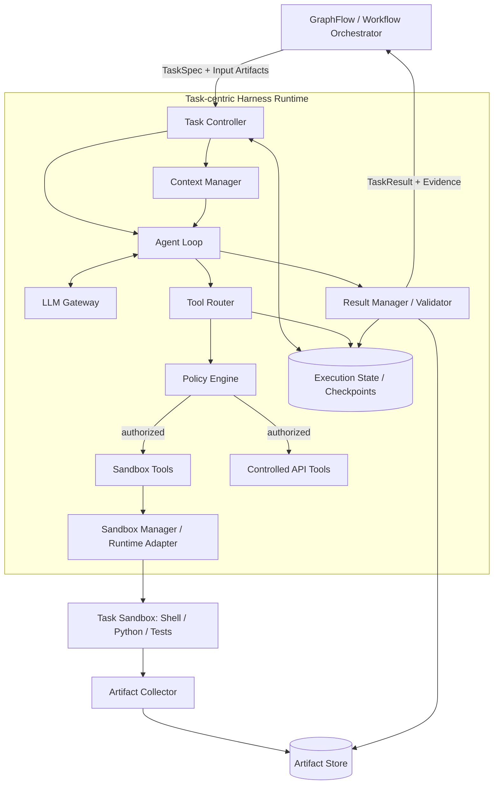
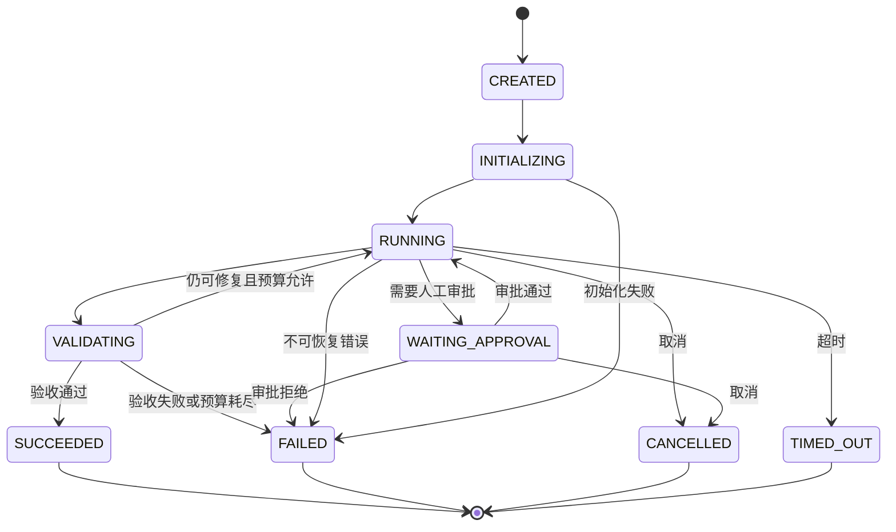

# Task-centric Agent Harness 架构设计方案

> 版本：v1.0（MVP 架构基线）  
> 日期：2026-11-08  
> 适用范围：面向 SPEC-GraphFlow / AI 软件生产平台的单 Task 智能执行运行时  
> 状态：设计建议，待原型验证

## 1. 文档目的

本文沉淀以 **Task 为基本执行单位**的 Agent Harness 架构设计，明确与 GraphFlow、Agent、Agent Loop、Tools、Policy Engine、Docker Sandbox、Artifacts、Evidence 的职责边界，为第一版 MVP 的接口设计、模块开发及后续扩展提供基线。

### 1.1 核心结论

**Agent Harness 是以 LLM 为决策核心、以 Tools 为行动手段、以 Task 为执行目标的受控智能任务运行时（Controlled Agent Execution Runtime）。**

- **Task**：说明要完成什么、输入是什么、有哪些约束、如何验收。
- **TaskExecution**：一次 Task 的具体执行实例及状态；一个 Task 可以有多次 Execution。
- **AgentProfile**：可复用的角色、提示词和默认能力配置；不能自行扩大 Task 授权。
- **Agent Loop**：在 Task 内驱动 LLM → Tool → Observation 的循环。
- **Harness**：管理 Task 执行全生命周期，包括上下文、工具、权限、预算、状态、恢复与结果。
- **Sandbox**：隔离高风险 Tool 的操作系统资源和副作用，并不是替代 Tool Policy。
- **GraphFlow**：负责任务之间的 DAG 依赖、调度和工作流级状态，不介入 Task 内每次 LLM/Tool 调用。

**设计原则：一个 Task 对应一次逻辑 Harness Execution，不等于一个 Task 必须启动一个独立 Harness 服务进程或 Docker 容器。**

## 2. 目标与非目标

### 2.1 MVP 目标

1. 接收结构化 `TaskSpec`，自动建立一次 `TaskExecution`。
2. 通过外部 LLM API 完成多轮决策与工具执行。
3. 对 Tool Call 进行 schema 校验、授权、预算和审计。
4. 将 Shell、Python、构建与测试等高风险执行交给受限 Sandbox。
5. 保存状态、日志、Artifact 与 Evidence，输出结构化 `TaskResult`。
6. 支持任务成功、失败、取消、超时以及最小化重试/恢复机制。
7. 与 GraphFlow 通过稳定的 Task 提交与结果接口解耦。

### 2.2 MVP 非目标

- Harness 内部复杂多 Agent 自治协作；
- 长期共享的 Agent Memory 系统；
- 分布式 Kubernetes/MicroVM 调度平台；
- 自适应动态 DAG 规划；
- 完整策略规则语言及大型审批平台。

上述能力应在 Task 执行契约稳定后增量建设。

## 3. 核心概念与职责边界

| 概念 | 核心职责 | 不应承担的职责 |
| --- | --- | --- |
| GraphFlow | Workflow DAG、Task 依赖、调度、流程级重试与 Gate | Task 内部 LLM/Tool 循环 |
| TaskSpec | 目标、输入、约束、验收契约 | 可变运行状态 |
| TaskExecution | 一次执行的 ID、状态、消息、预算、日志和 Sandbox 引用 | Workflow 级依赖管理 |
| AgentProfile | 角色、默认提示词、工具偏好 | 授权提升 |
| Agent Loop | LLM 决策、Tool Call、Observation、继续或结束 | 越过权限直接操作宿主机 |
| Context Manager | 对话历史、摘要、上下文裁剪、输入材料 | Task 权限决策 |
| Tool Router | Tool Schema、分发、参数校验、审计 | 无边界的系统权限 |
| Policy Engine | Task/Tool/资源级权限及风险策略 | LLM 推理 |
| Sandbox Manager | 创建、执行、收集、销毁受限环境 | Task 语义验收 |
| Result Manager | Artifact、Evidence、结果归档 | 自然语言宣称即成功 |

### 3.1 GraphFlow 与 Harness 的边界

```text
GraphFlow（任务之间的编排）
  └─ TaskSpec + Input Artifacts
       ↓
    Harness（任务内部的执行）
       ├─ Task Controller
       ├─ Context Manager / LLM Gateway / Agent Loop
       ├─ Tool Router + Policy Engine
       ├─ Sandbox Adapter / Controlled API Tools
       └─ Result Manager + State Store
       ↓
  TaskResult + Evidence + Artifacts
       ↓
GraphFlow（Gate、后续节点、Workflow 结果）
```

**GraphFlow 关注哪个 Task 何时执行、依赖是否满足；Harness 关注当前 Task 如何被 Agent 完成。**

## 4. 总体架构



> 说明：逻辑上以 TaskExecution 为单位隔离状态和权限；部署上可由多个 Harness Worker 共享同一运行时代码，并由 Sandbox Worker 独立管理容器。

### 4.1 六个 MVP 模块

1. **Task Controller**：初始化、执行、取消、超时、状态迁移、结束清理。
2. **Agent Loop**：多轮 LLM → Tool → Observation，判定停止条件。
3. **Context Manager**：系统提示、任务输入、历史 Tool 输出、上下文压缩。
4. **Tool Router + Policy Engine**：参数验证、授权、工具分发、审计。
5. **Sandbox Adapter**：高风险 Tool 的受限运行与环境回收。
6. **Result Manager**：输出验证、Artifact/Evidence 持久化、TaskResult。

横切能力：**LLM Gateway、状态存储、指标与日志、预算与超时**。

## 5. 核心领域模型与接口契约

### 5.1 TaskSpec（不可变执行契约）

```json
{
  "task_id": "task-001",
  "objective": "实现用户登录接口",
  "agent_profile": "backend-developer",
  "inputs": {
    "repository_ref": "artifact://repo-snapshot-001",
    "requirements": "实现 JWT 登录接口"
  },
  "constraints": {
    "allowed_tools": ["read_file", "write_file", "shell_exec"],
    "sandbox_required": true,
    "max_iterations": 30,
    "max_duration_seconds": 600,
    "max_tool_calls": 50
  },
  "acceptance": {
    "required_tests": true
  }
}
```

说明：`allowed_tools` 是 Task 级上限，实际授权还必须与调用者权限、平台策略求交集；任务输入不可直接决定宿主权限。

### 5.2 AgentProfile（可复用角色模板）

```json
{
  "name": "backend-developer",
  "system_prompt_ref": "prompt://backend-developer/v1",
  "model_ref": "configured-llm",
  "tool_preferences": ["read_file", "write_file", "shell_exec"]
}
```

AgentProfile 提供角色与默认配置，不是安全授权主体。

### 5.3 TaskExecution（一次实际执行）

```json
{
  "execution_id": "exec-002",
  "task_id": "task-001",
  "attempt": 2,
  "status": "RUNNING",
  "iteration": 8,
  "sandbox_id": "sandbox-xyz",
  "checkpoint_ref": "checkpoint://exec-002/08",
  "token_usage": 18340,
  "started_at": "2026-11-08T10:00:00Z"
}
```

一个 Task 可能有多个 Execution，重试必须使用新的 `execution_id`，避免将失败状态与新尝试混淆。

### 5.4 ToolCall / ToolResult

```json
{
  "tool_call_id": "call-0001",
  "tool_name": "shell_exec",
  "arguments": {"command": "python -m pytest -q"}
}
```

```json
{
  "tool_call_id": "call-0001",
  "status": "completed",
  "exit_code": 0,
  "stdout": "12 passed",
  "stderr": "",
  "duration_ms": 530
}
```

ToolResult 应支持 `completed`、`failed`、`timeout`、`denied`、`cancelled` 等状态，并保留统一调用 ID；输出应有长度上限。

### 5.5 TaskResult（结束契约）

```json
{
  "task_id": "task-001",
  "execution_id": "exec-002",
  "status": "succeeded",
  "summary": "登录接口已实现并通过测试",
  "artifacts": ["artifact://login-source", "artifact://test-report"],
  "evidence": {
    "tests_passed": 12,
    "tests_failed": 0
  }
}
```

`status=succeeded` 必须经过可定义的验收规则确认，不能仅凭模型自称完成。

## 6. Task 生命周期与状态机



**资源清理是所有终态必须执行的收尾动作**，包括 Sandbox 回收、Artifact 收集、日志写入与最终状态持久化，不应只依赖当前进程内的 `finally`；生产中还需独立 Reconciler 回收孤儿容器。

### 6.1 执行序列

1. GraphFlow 提交 `TaskSpec`。
2. Task Controller 验证任务、冻结权限和预算，创建 `TaskExecution`。
3. 按需准备 Sandbox、装载输入 Artifact。
4. Context Manager 准备消息，Agent Loop 调用 LLM。
5. 如果返回 Tool Calls：校验 Schema → Policy 授权 → Router 执行 → 记录 Observation。
6. 重复步骤 4–5，直到模型提出完成、触发限制、出现失败或等待审批。
7. Result Manager 执行验收与 Evidence 收集。
8. 收集和持久化产物，清理 Sandbox，保存 TaskResult。
9. GraphFlow 根据 TaskResult 判断后续 DAG 节点和流程 Gate。

## 7. Agent Loop 设计

```python
class HarnessRuntime:
    async def run(self, task_spec):
        execution = await self.initialize(task_spec)
        try:
            while not execution.is_terminal:
                await self.check_budget_and_cancellation(execution)
                context = await self.context_manager.build(execution)
                response = await self.llm_gateway.generate(context)

                if response.tool_calls:
                    tool_results = await self.tool_router.execute_many(
                        execution=execution,
                        calls=response.tool_calls,
                    )
                    await self.context_manager.append_tool_results(
                        execution, tool_results
                    )
                else:
                    await self.evaluate_completion(execution, response)

                await self.checkpoint(execution)

            return await self.result_manager.finalize(execution)
        finally:
            await self.cleanup(execution)
```

> 伪代码只展示职责边界。实现时应处理 LLM 请求重试、并发 Tool 调用一致性、取消传播、超时强制终止、幂等清理和异常路径上的结果落库。

### 7.1 Loop 退出条件

- 验收完成；
- 达到最大轮次、Token/成本、工具调用次数或墙钟时长；
- 用户取消；
- 模型或工具产生不可恢复错误；
- 需要人工审批时进入暂停状态，而不是阻塞占用执行资源。

## 8. Tool 与 Sandbox 设计

### 8.1 Tool 两类执行路径

| 类型 | 示例 | 执行方式 |
| --- | --- | --- |
| Sandbox Tools | `shell_exec`、`python_exec`、编译、测试、工作区文件编辑 | 经 Policy 校验后由 Sandbox Worker 在隔离环境内执行 |
| Controlled API Tools | 数据库访问、Git Remote、部署、邮件与外部服务 API | 在可信服务端执行资源级授权、最小权限与必要审批 |

**不是所有 Tool 都必须运行在容器内。** Sandbox 重点处理代码执行、构建脚本及可能产生不受控子进程的工具；业务 API 的权限必须由 API 侧单独保证。

### 8.2 SandboxRuntime 抽象

```python
from abc import ABC, abstractmethod

class SandboxRuntime(ABC):
    @abstractmethod
    async def create(self, execution_id, policy): ...

    @abstractmethod
    async def execute(self, sandbox_id, command, timeout_s): ...

    @abstractmethod
    async def collect(self, sandbox_id): ...

    @abstractmethod
    async def destroy(self, sandbox_id): ...
```

初版实现 `DockerRuntime`，后续可扩展 `KubernetesRuntime`、`MicroVMRuntime`、`RemoteSandboxRuntime`，不改变 Agent Loop 接口。

### 8.3 一 Task 一逻辑 Sandbox（MVP 默认）

- Task 开始时按需创建 Sandbox。
- Task 内连续 Tool Call 复用工作空间及依赖。
- Task 结束或失败时，先收集 Artifact，再销毁 Sandbox。
- 高风险、强隔离要求的 Tool Call 可以单独使用一次性 Sandbox。
- Task 和 Sandbox 是不同实体：一次 Execution 允许在故障恢复时重新分配 Sandbox。

### 8.4 Docker 隔离与风险控制

- Mount Namespace、独立根文件系统：隔离文件系统视图；
- PID、IPC、Network Namespaces：隔离进程、通信和网络环境；
- 用户权限、User Namespace（按配置）、Capabilities、seccomp/LSM：减少可执行的特权操作；
- cgroups：限制 CPU、内存、进程数量；
- 限制网络、挂载、环境变量、临时空间和执行时长；
- **禁止向 Agent Sandbox 挂载 Docker Socket、宿主根目录和敏感凭证。**

Docker 容器不是完整强安全沙箱：共享宿主 Linux 内核，不能完全规避内核漏洞或容器逃逸。对于运行高风险、多租户不可信任意代码的生产平台，应考虑独立 Worker、microVM 或同等强隔离方案。

## 9. Policy、预算与验证

### 9.1 Policy Engine 需要检查

1. 任务是否允许使用该 Tool；
2. 调用者是否有权访问目标资源；
3. 参数格式与路径、网络目标是否合法；
4. 是否涉及高风险副作用（例如 push、部署、数据库写入）；
5. 是否需要人工审批；
6. 是否超过任务预算或并发限额。

Prompt 中的“禁止危险操作”只是一种行为引导，**不等于系统级权限控制**。

### 9.2 双层预算

| 层级 | 预算示例 | 管理者 |
| --- | --- | --- |
| Task / Agent Loop | 最大轮次、LLM Token、费用、总时长、Tool 次数 | Task Controller |
| Tool / Sandbox | 单命令墙钟超时、CPU、内存、PID、日志大小、网络 | Sandbox Manager / Worker |

发生超时不能只停止等待 Tool 结果，还要实际终止相应进程或容器，防止遗留后台任务。

### 9.3 Evidence 与验收

- 验收输入来自 TaskSpec 的验收契约。
- Evidence 可包括测试退出码、测试报告、构建日志、Git Diff、静态检查结果。
- Result Manager 应区分“模型宣称完成”与“验收通过”。
- GraphFlow 可在 TaskResult 基础上施加更高一层的流程 Gate。

## 10. 持久化、恢复与可观测性

### 10.1 需要持久化的数据

- `TaskSpec` 与授权策略快照；
- `TaskExecution` 状态、attempt、轮次、耗时与 Token 使用量；
- LLM 请求/响应引用与 Tool Call/Result；
- Sandbox ID、Worker ID、租约与心跳；
- Checkpoint、Artifact 和 Evidence 引用；
- 验收结果和错误原因。

### 10.2 崩溃与重试

- 使用 `task_id` 表示逻辑任务，用 `execution_id` 表示每次尝试。
- 任务重试创建新的 Execution；从持久化 Checkpoint 继续时应识别已有执行动作的副作用。
- 对于外部 API 写操作，使用幂等键或执行前确认，避免故障重试造成重复提交。
- Sandbox 回收由异步 Reconciler 兜底，不能只依赖进程内 `finally`。
- Checkpoint 不等于完整进程快照：重新分配 Sandbox 后可能需要从 Artifact 恢复工作区。

### 10.3 建议日志字段

`trace_id`, `task_id`, `execution_id`, `iteration`, `tool_call_id`, `sandbox_id`, `policy_decision`, `latency_ms`, `token_usage`, `error_code`。

## 11. MVP 工程目录建议

```text
agent-platform/
├── graphflow/
│   ├── scheduler.py
│   └── task_graph.py
├── harness/
│   ├── task_controller.py
│   ├── agent_loop.py
│   ├── context_manager.py
│   ├── llm_gateway.py
│   ├── tool_router.py
│   └── result_manager.py
├── policy/
│   └── policy_engine.py
├── sandbox/
│   ├── runtime.py
│   ├── docker_runtime.py
│   ├── sandbox_manager.py
│   ├── artifact_collector.py
│   └── reconciler.py
├── tools/
│   ├── shell_tool.py
│   ├── file_tool.py
│   └── test_tool.py
├── storage/
│   ├── execution_repository.py
│   └── artifact_store.py
└── api/
    └── task_api.py
```

## 12. 实施阶段与验收标准

### Phase 1：单 Task + 单 Agent + 单 Sandbox

- TaskSpec → Harness → TaskResult 路径贯通；
- LLM 可调用 `read_file`、`write_file`、`shell_exec`；
- 一次 Task 的多次 Tool Call 复用 Sandbox；
- 成功、失败都能回收容器并保存产物。

**验收**：输入一个简单开发任务，完成写代码、运行测试、返回 Artifact 和 Evidence。

### Phase 2：受控执行

- 参数/schema 校验、Task 级 Tool 授权；
- CPU、内存、进程数、执行超时与日志限制；
- 取消传播、审计日志、Checkpoint；
- 孤儿 Sandbox 资源回收。

**验收**：越权请求被拒绝；死循环/超时任务受到限制；Worker 异常后能检测和回收残留资源。

### Phase 3：接入 GraphFlow

- DAG Task 依赖与任务提交；
- TaskResult 标准接口；
- Artifact 跨 Task 传递；
- 流程 Gate、失败分支、任务重试。

**验收**：需求分析 → 代码生成 → 测试 → 审查 → 交付的基础链路可运行。

### Phase 4：扩容与安全强化

- 多 Worker 分配和状态同步；
- 调度配额与租约；
- 更强网络策略、依赖代理；
- 按威胁模型评估 microVM、远程 Sandbox。

**验收**：并发 Task 不串状态、不串数据，故障可恢复或明确失败，资源能被可靠回收。

## 13. 推荐的不可妥协设计原则

1. **Task 定义执行边界，Execution 定义一次运行实例。**
2. **AgentProfile 提供能力偏好，不授予权限。**
3. **Harness 管 Task 内动态执行，GraphFlow 管 Task 间编排。**
4. **Agent Loop 是 Harness 的核心，但不等于 Harness 全部。**
5. **所有 Tool Call 通过 Tool Router 与 Policy Engine，不能绕过授权。**
6. **Sandbox 管系统执行边界，不替代业务 API 权限。**
7. **Sandbox 应可销毁，Artifact 和 Evidence 必须持久化。**
8. **任务成功需要客观验收证据，不能只依赖模型自我声明。**
9. **超时、取消、重试、恢复必须有确定语义与审计记录。**
10. **先构建可用的单 Task 运行时，再扩展分布式和多 Agent。**

## 14. 一句话架构定义

**SPEC 定义目标、约束与验收 → GraphFlow 编排 Task → Task-centric Harness 受控驱动 Agent Loop → Tool Router/Policy 决定可执行操作 → Sandbox 隔离高风险执行 → Artifact/Evidence 保留可验证产出 → GraphFlow 根据 TaskResult 进行流程推进。**

---

*本文是架构设计基线。各 JSON / Python 片段均为说明性契约或伪代码，实际实现需进一步定义错误码、数据库模型、鉴权机制、并发一致性和运行时部署策略。*
