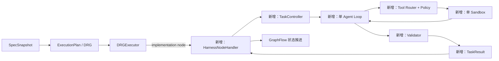
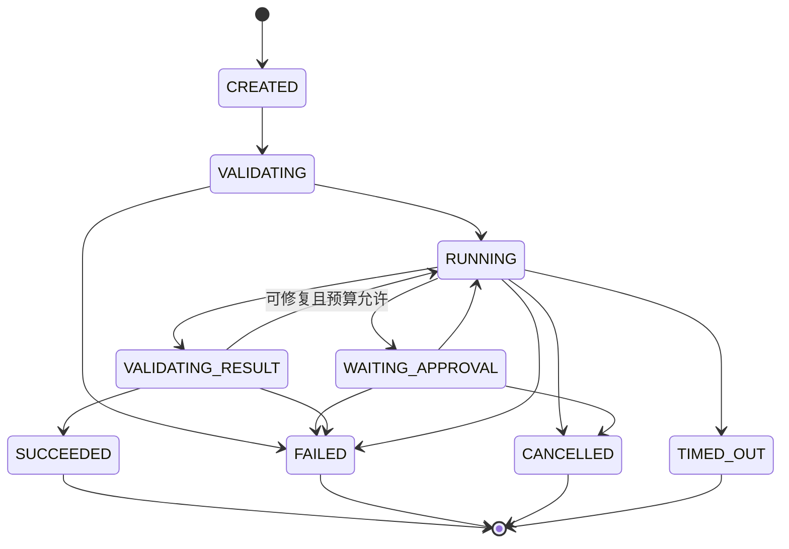
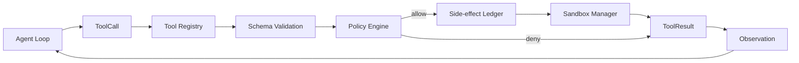
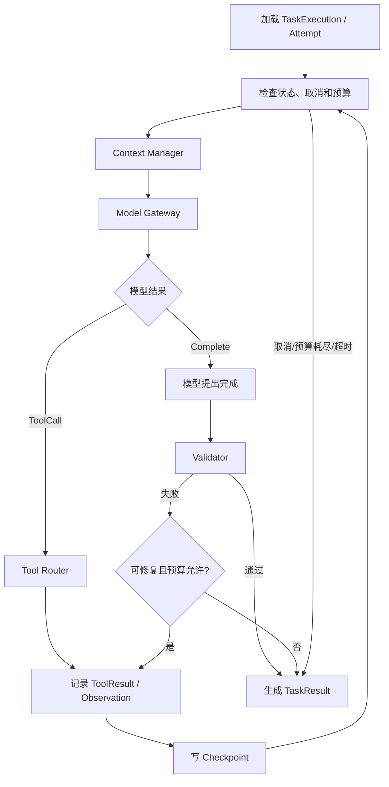
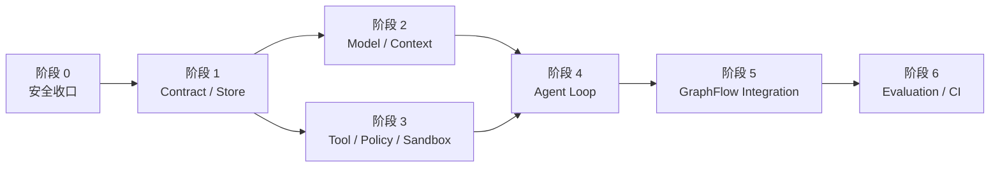

# Agent-Harness MVP 详细修改计划

## 1. 建设目标

本阶段只完成一个工程化纵向闭环：

> **单 Task、单 Agent、单 Sandbox，在明确预算和权限边界内完成多轮模型决策与工具调用，并输出可验证、可恢复、可审计的 TaskResult。**

本阶段不追求多 Agent、分布式调度、长期记忆、插件市场或复杂工作流。现有 SPEC-GraphFlow 继续作为外层确定性编排系统，新增 Agent-Harness 作为节点内部的任务执行内核。

### 1.1 MVP 完成定义

以下条件必须同时成立：

1. 一个 GraphFlow implementation 节点能够创建一个 TaskExecution；
2. TaskExecution 只绑定一个版本化 AgentProfile；
3. Agent 能通过 Model Gateway 进行多轮推理；
4. Agent 可以调用 `read_file`、`write_file`、`shell_exec` 三个基础工具；
5. 所有 ToolCall 都经过 Schema 校验、PolicyDecision 和 Tool Router；
6. 文件、Shell、构建和测试只在单个隔离 Sandbox 中执行；
7. 一次 Attempt 内复用同一个 Sandbox 工作空间；
8. 最大轮次、Token、费用、Tool 次数和总时长受到强制限制；
9. 支持暂停、取消、超时、失败和安全恢复；
10. 模型提出完成后必须经过确定性 Validator；
11. 最终输出标准 TaskResult、Artifact、Evidence 和完整事件时间线；
12. GraphFlow 只根据 TaskResult 推进节点，不读取 Agent 内部推理细节；
13. Golden Cases 覆盖正常、越权、超时、取消、恢复和幂等场景；
14. 正式模式下不存在 deterministic success fallback 和宿主 `shell=True` 执行路径。

### 1.2 当前实施状态

| 阶段 | 状态 | 验证结果 |
|---|---|---|
| 阶段 0：工程基线与危险路径收口 | 已实现，本地验收通过 | 130 个测试通过；中文注释门禁通过；正式模式 fail-closed；宿主 Shell 默认阻断；路径越界测试通过；`pyproject.toml` 有效 |
| 阶段 1：Task Contract、状态与持久化 | 已实现，本地验收通过 | 141 个测试通过；Task/Execution/Attempt 契约与状态机、CAS 原子存储及中断恢复、追加事件、Execution Lease、不可变 Checkpoint 和重启恢复测试通过 |
| 阶段 2：Model Gateway 与 Context Manager | 已实现，本地验收通过 | 153 个测试通过；Responses Provider Adapter、有限重试/超时/Schema 校验、跨重试用量与可配置费用、版本化 AgentProfile、确定性上下文预算及模型事件脱敏通过 |
| 阶段 3：Tool Router、Policy 与单 Sandbox | 代码完成，自动化验收通过；真实 Docker 冒烟待环境 | 169 个测试通过，1 个真实 Docker 冒烟测试因当前机器无 Docker CLI 跳过；Registry/Schema/Policy/Ledger/Router、三个基础工具、单 Attempt Sandbox、Docker 安全参数、超时/输出终止命令、Artifact 收集通过 |
| 阶段 4：Agent Loop、预算、取消与恢复 | 已实现，本地自动化验收通过 | 181 个测试通过，1 个真实 Docker 冒烟测试跳过；多轮 ToolCall、原子预算、暂停/恢复、模型与 Sandbox 取消、Checkpoint 重启恢复、过期 Lease、不确定副作用和孤儿 Sandbox 扫描通过 |
| 阶段 5：Validator、TaskResult 与 GraphFlow 接入 | 已实现，本地自动化验收通过 | 187 个测试通过，1 个真实 Docker 冒烟测试因当前机器无 Docker CLI 跳过；完成确定性 Validator、TaskResult/Evidence、GraphFlow Handler、Gate Sandbox 迁移、重试分类与运维 CLI |
| 阶段 6：可观测性、Golden Cases 与发布门禁 | 已实现，本地自动化验收通过 | 194 个测试通过，1 个真实 Docker 冒烟测试因当前机器无 Docker CLI 跳过；完成脱敏 Timeline、Metrics、12 个 Golden Cases、评测运行/版本比较与 CI 发布门禁 |
| 阶段 7：本地工程快照与生产闭环 | 已实现 MVP 基础链路 | RuntimeFactory、local_snapshot、ChangeSet 安全回写、真实 resume、租约心跳、异常 Guard、OS 文件锁与镜像追溯约束已接入 |

阶段 0 已新增跨平台 CI 配置，但远端 CI 是否通过需要在代码推送后由 CI 环境确认。

### 1.3 中文注释强制规范

Agent-Harness 基础设施代码必须通过中文注释保留设计意图，不能只描述语法行为。

强制要求：

1. 新增 Python 模块必须提供中文模块 docstring；
2. 新增公共 Class、Function 和 Method 必须提供中文 docstring；
3. docstring 必须同时回答“当前内容做什么”和“位于 Harness/GraphFlow 哪个架构边界或流程环节”；
4. 安全、状态转换、权限、预算、恢复和副作用代码必须在关键判断处补充中文行内注释；
5. GraphFlow/Harness 桥接代码必须说明上游输入、下游输出和职责归属；
6. Mock/Fake/兼容路径必须明确说明适用范围，并标注禁止进入正式 Harness 流程；
7. 配置、CI 和脚本需要说明其在工程门禁、打包或运行流程中的作用；
8. 禁止使用只重复函数名、参数名或代码字面行为的无信息注释。

自动门禁：

- `scripts/check_harness_comments.py` 检查阶段 0 的关键桥接点；
- 后续出现 `harness/` 包后，检查器自动扫描全部公共模块、类、函数和方法；
- 本地单元测试和 CI 都执行该策略；缺少中文职责或流程位置说明时构建失败。

---

## 2. 修改发生在系统的什么位置

### 2.1 总体插入位置



### 2.2 现有流程与修改后流程

#### 当前流程

```text
DRGExecutor
→ 准备 ContextPack
→ 查找可选 Python Handler
→ 没有 Handler 时写入 deterministic success Artifact
→ Gate 直接在宿主执行 Spec shell check
→ 节点完成
```

#### 修改后流程

```text
DRGExecutor
→ HarnessNodeHandler 将 Graph Node 转换为 Task Contract
→ TaskController 创建 TaskExecution + Attempt
→ 创建并绑定单 Sandbox
→ Context Manager 组装上下文
→ Agent Loop 调用 Model Gateway
→ 模型返回 ToolCall
→ Tool Router 校验 ToolCall
→ Policy Engine 授权或拒绝
→ Sandbox Worker 执行 Tool
→ ToolResult 作为 Observation 返回 Agent Loop
→ 模型提出完成
→ Validator 执行确定性验收
→ 生成 TaskResult + Artifact + Evidence
→ GraphFlow 根据 TaskResult 完成、重试或升级节点
```

### 2.3 现有模块的处置方式

| 当前模块 | 系统位置 | 处置 | 修改后的职责 |
|---|---|---|---|
| `scheduler/executor.py` | GraphFlow 执行控制 | 重构 | 只负责节点顺序和 TaskResult 映射，不理解 LLM/Tool/Sandbox |
| `scheduler/agent_invoker.py` | 节点上下文准备 | 重构 | 变为 GraphFlow → Harness 的 Task 输入适配器，或由 `HarnessNodeHandler` 取代 |
| `scheduler/tool_contracts.py` | 静态能力声明 | 保留并降级 | 作为 AgentProfile 和 Policy 的输入，不再被视为最终权限边界 |
| `scheduler/gates.py` | 验收命令执行 | 替换危险路径 | 不再直接执行 Shell；验收通过 Harness Tool Router/Sandbox 执行 |
| `scheduler/gate_auto.py` | 验收规则选择 | 保留 | 只解析验收规则，生成 Validator 请求 |
| `scheduler/runs.py` | GraphRun 状态 | 保留外层职责 | 增加 TaskExecution 引用，不保存 Agent 内部状态 |
| `scheduler/events.py` | GraphFlow 节点事件 | 保留 | 记录 Task 创建和 TaskResult；Harness 使用独立细粒度事件流 |
| `scheduler/retry_policy.py` | GraphFlow 节点重试 | 拆分 | 保留节点级重试；Attempt 内重试由 Harness 管理 |
| `scheduler/artifacts.py` / Evidence | 产物治理 | 复用 | 接收 Harness TaskResult、Artifact 和 Evidence 引用 |
| `agents/*.md` | Agent 角色声明 | 迁移 | 转换成版本化 AgentProfile + Prompt 文件 |
| Legacy TaskCard 状态机 | 旧执行路径 | 冻结 | 只做迁移兼容，不接入 Harness 新能力 |

---

## 3. 目标代码结构

建议新增独立 `harness/` 包，避免把 Agent 内部循环继续堆入 `scheduler/`：

```text
harness/
├── __init__.py
├── contracts.py              # Task、TaskExecution、Attempt、TaskResult
├── state_machine.py          # TaskExecution / Attempt 合法状态转换
├── controller.py             # 创建、运行、暂停、恢复、取消 TaskExecution
├── agent_loop.py             # Reason → Act → Observe → Validate 循环
├── context_manager.py        # Prompt、历史、Observation、Token 预算
├── budget.py                 # 轮次、Token、费用、Tool、时长计量
├── validation.py             # 完成条件与确定性验收
├── errors.py                 # 稳定错误码与错误分类
│
├── models/
│   ├── base.py               # ModelGateway 接口
│   ├── gateway.py            # 路由、重试、Schema、用量统计
│   └── provider_adapter.py   # MVP 的单一模型供应商适配器
│
├── tools/
│   ├── contracts.py          # ToolDefinition、ToolCall、ToolResult
│   ├── registry.py           # 工具注册与版本
│   ├── router.py             # 所有 ToolCall 的唯一执行入口
│   ├── policy.py             # PolicyDecision
│   ├── ledger.py             # 副作用、幂等、started/completed 账本
│   ├── read_file.py
│   ├── write_file.py
│   └── shell_exec.py
│
├── sandbox/
│   ├── base.py               # SandboxRuntime 接口
│   ├── manager.py            # create/exec/cancel/destroy/reconcile
│   ├── docker_runtime.py     # 正式 MVP 隔离实现
│   └── fake_runtime.py       # 单元测试专用，禁止生产使用
│
├── persistence/
│   ├── task_store.py         # TaskExecution / Attempt 原子持久化
│   ├── event_store.py        # 有序追加事件
│   ├── artifact_store.py     # Artifact 与 Evidence
│   └── locks.py              # 单执行租约与并发保护
│
├── observability/
│   ├── timeline.py
│   ├── metrics.py
│   └── redaction.py
│
└── integration/
    ├── graphflow_handler.py  # GraphFlow Node ↔ Harness TaskResult
    └── agent_profile.py      # agents/*.md → AgentProfile

tests/
├── unit/harness/
├── integration/harness/
├── e2e/harness/
└── golden/
    ├── cases/
    └── expected/
```

### 3.1 运行数据目录

建议在现有 `.loop/` 下增加独立 Harness 数据域：

```text
.loop/
├── runs/{graph_run_id}/                 # 现有 GraphFlow 数据
└── harness/
    ├── tasks/{task_id}/task.json
    ├── executions/{execution_id}/
    │   ├── execution.json
    │   ├── attempts/{attempt_id}.json
    │   ├── events.jsonl
    │   ├── tool-ledger.jsonl
    │   ├── checkpoints/
    │   └── artifacts/
    └── agents/{agent_id}/{version}/
        ├── profile.json
        └── prompt.md
```

GraphRun 只保存：

```json
{
  "task_refs": [
    {
      "node_id": "implementation_node",
      "task_id": "task-...",
      "execution_id": "exec-...",
      "result_ref": ".loop/harness/executions/.../task-result.json"
    }
  ]
}
```

---

## 4. 核心领域模型与状态机

### 4.1 领域对象

| 对象 | 所属层 | 用途 |
|---|---|---|
| Task | GraphFlow/Harness 边界 | 不可变目标、输入、权限、预算和验收合同 |
| TaskExecution | Harness 控制层 | 一次任务运行，绑定版本、预算和当前状态 |
| Attempt | Harness 执行层 | 一次具体尝试；重试创建新 Attempt |
| AgentProfile | Agent Runtime | Prompt、模型策略、Tool 偏好和上下文策略 |
| ToolCall | Tool 层 | Agent 提出的结构化动作 |
| PolicyDecision | Policy 层 | allow / deny / require_approval 及原因 |
| ToolResult | Tool 层 | completed / failed / timeout / denied / cancelled |
| Checkpoint | 恢复层 | 安全边界上的运行快照和引用 |
| Artifact | 产物层 | 文件、代码、报告和测试结果 |
| Evidence | 验证层 | 支撑验收结论的可验证证据 |
| TaskResult | GraphFlow/Harness 边界 | succeeded / failed / cancelled / timed_out |

### 4.2 TaskExecution 状态机



### 4.3 Attempt 状态

```text
PENDING → PREPARING_SANDBOX → RUNNING
→ CHECKPOINTED / SUCCEEDED / FAILED / CANCELLED / TIMED_OUT / NEEDS_RECONCILIATION
```

任何新的自动重试都必须创建新 `attempt_id`。旧 Attempt 状态、事件、预算和 Tool Ledger 不可覆盖。

---

## 5. 分阶段修改计划

### 阶段 0：工程基线与危险路径收口

#### 目标

在引入 Agent Loop 前，先保证正式执行不会伪造成功或直接执行不受控宿主命令。

| 工作包 | 架构位置 | 流程环节 | 修改内容 | 涉及文件 |
|---|---|---|---|---|
| M0-1 显式执行模式 | GraphFlow 执行层 | 节点 Handler 选择 | 增加 `execution_mode=harness/mock`；mock 只能由测试显式启用 | `scheduler/executor.py`、`scheduler/main.py` |
| M0-2 Fail-closed | GraphFlow 执行层 | 未找到 Handler | 正式模式没有 Handler 时返回结构化失败，禁止写 success Artifact | `scheduler/executor.py` |
| M0-3 关闭宿主 Shell | Gate 执行层 | 验收命令执行 | 正式模式禁用 `subprocess.run(..., shell=True)`；先返回 `sandbox_required` | `scheduler/gates.py`、`scheduler/gate_auto.py` |
| M0-4 路径安全 | Persistence | Run/Artifact 路径解析 | 校验 ID 格式；resolve 后必须位于授权根目录 | `scheduler/runs.py`、新增 `harness/persistence/` |
| M0-5 工程包装 | 构建与 CI | 安装、测试、发布 | 增加项目元数据、依赖锁定、格式检查、单测入口和 CI | `pyproject.toml`、CI 配置 |

#### 验收条件

- 未配置真实 Harness Handler 时，正式执行明确失败；
- 当前 GraphFlow 测试通过显式 mock 模式继续运行；
- Spec 中任意 Shell 命令不能在正式模式宿主执行；
- `../`、绝对路径和非法 run_id 被拒绝；
- 现有 123 个测试迁移后继续通过。

#### 回滚策略

保留 `mock` 模式用于测试，但不允许由生产入口默认启用。若 Harness 尚未可用，系统应 fail-closed，而不是回退到旧宿主执行路径。

---

### 阶段 1：Task Contract、状态与持久化

#### 目标

建立 Harness 的稳定领域边界，使 Agent、Tool、Sandbox 和 GraphFlow 不通过临时字典耦合。

| 工作包 | 架构位置 | 流程环节 | 修改内容 | 新增/修改文件 |
|---|---|---|---|---|
| M1-1 Task Contract | GraphFlow/Harness 边界 | Node → Task | 定义目标、输入引用、权限、预算、验收、版本闭包 | `harness/contracts.py` |
| M1-2 Execution/Attempt | Harness 控制层 | 创建运行 | 定义 TaskExecution 和 Attempt，重试不覆盖旧 Attempt | `harness/contracts.py` |
| M1-3 状态机 | Harness 控制层 | 全生命周期 | 集中校验合法状态转换和终态不可变性 | `harness/state_machine.py` |
| M1-4 原子 TaskStore | Persistence | 每次状态更新 | 临时文件 + flush + 原子替换；state_version/CAS | `harness/persistence/task_store.py` |
| M1-5 EventStore | Observability | 每个状态/动作 | event_id、sequence、timestamp、causation_id、payload | `harness/persistence/event_store.py` |
| M1-6 Lease/Lock | Persistence | Worker 领取执行 | 单 execution 租约，防止重复 Worker 同时运行 | `harness/persistence/locks.py` |
| M1-7 Checkpoint | Recovery | 每轮与 ToolResult 后 | 保存 round、usage、message refs、tool ledger position、artifact refs | `harness/controller.py`、Persistence |

#### 建议的 Task 必填字段

```json
{
  "task_id": "task-...",
  "source": {
    "graph_run_id": "run-...",
    "node_id": "implementation_node"
  },
  "objective": "实现并验证指定变更",
  "input_refs": [],
  "agent_profile": {"id": "backend-dev", "version": "1.0.0", "hash": "..."},
  "permissions": {
    "tools": ["read_file", "write_file", "shell_exec"],
    "workspace_root": "workspace",
    "network": "deny"
  },
  "budget": {
    "max_rounds": 20,
    "max_tool_calls": 50,
    "max_wall_seconds": 900,
    "max_model_tokens": 100000,
    "max_cost": null
  },
  "acceptance": [],
  "version_set": {}
}
```

#### 验收条件

- 非法状态转换被拒绝并写入事件；
- 同一个 execution 不能被两个 Worker 同时领取；
- 进程在任意状态写入点崩溃后，JSON 不损坏；
- 新 Attempt 不覆盖旧 Attempt；
- 根据 Event 和 Checkpoint 可以定位最后一个安全恢复点。

---

### 阶段 2：Model Gateway 与 Context Manager

#### 目标

建立单 Agent 的模型调用基础，但暂不开放工具执行。

| 工作包 | 架构位置 | 流程环节 | 修改内容 | 新增文件 |
|---|---|---|---|---|
| M2-1 Model 接口 | Model 层 | Agent 每轮推理 | 统一 request/response、ToolCall、usage、finish_reason | `harness/models/base.py` |
| M2-2 Provider Adapter | Model 层 | 请求供应商 | 接入一个模型供应商；供应商 SDK 不泄露到 Agent Loop | `harness/models/provider_adapter.py` |
| M2-3 Gateway | Model 层 | 请求前后 | 超时、有限重试、结构化输出校验、用量统计、错误归一化 | `harness/models/gateway.py` |
| M2-4 AgentProfile | Agent Runtime | Context 构建前 | 将 Agent Markdown 迁移为版本化 profile + prompt | `harness/integration/agent_profile.py`、`.loop/harness/agents/` |
| M2-5 Context Manager | Agent Runtime | 每轮模型请求前 | 组装 Prompt、Task、历史、Observation；执行 Token 预算 | `harness/context_manager.py` |
| M2-6 脱敏 | Observability | 模型日志写入前 | 密钥、Token、敏感字段脱敏；原文与日志分权 | `harness/observability/redaction.py` |

#### 关键约束

- 模型名称、参数、Prompt/Profile hash 必须写入 version_set；
- 模型重试消耗总预算，不允许每次重试重新计算预算；
- Context Manager 决定模型能看到什么，Agent Loop 不直接拼接任意文件；
- 模型输出必须被视为不可信输入；
- 模型请求失败不能被转换为成功节点。

#### 验收条件

- 单 Agent 能完成一个不需要工具的结构化任务；
- 模型超时和无效 Schema 有有限重试；
- 每次请求记录模型版本、耗时、Token 和费用；
- 上下文超限时按照确定策略裁剪或失败；
- 日志中不出现模型 API 密钥。

---

### 阶段 3：Tool Router、Policy 与单 Sandbox

#### 目标

让 Agent 能安全调用三个基础工具，并确保没有旁路。

#### Tool 执行链位置



| 工作包 | 架构位置 | 流程环节 | 修改内容 | 新增文件 |
|---|---|---|---|---|
| M3-1 Tool Contracts | Tool 层 | 模型输出后 | ToolDefinition、ToolCall、ToolResult、稳定状态和错误码 | `harness/tools/contracts.py` |
| M3-2 Registry | Tool 层 | Tool 查找 | 注册工具名、版本、Schema、风险、超时、副作用属性 | `harness/tools/registry.py` |
| M3-3 Router | Tool 层 | 所有 Tool 执行 | 唯一入口；生成 call_id；不允许 Agent 直接持有执行器 | `harness/tools/router.py` |
| M3-4 Policy | Policy 层 | 执行前 | 计算 Task ∩ Agent ∩ Platform 权限；返回 allow/deny/approval | `harness/tools/policy.py` |
| M3-5 Ledger | Recovery 层 | 执行前后 | 记录 idempotency_key、started/completed/ambiguous | `harness/tools/ledger.py` |
| M3-6 Sandbox Interface | Sandbox 层 | Attempt 开始 | 定义 create/exec/cancel/destroy/inspect | `harness/sandbox/base.py` |
| M3-7 Docker Runtime | Sandbox 层 | Tool 执行 | 单 Attempt 单容器；受控 workspace volume；网络默认禁用 | `harness/sandbox/docker_runtime.py` |
| M3-8 Sandbox Manager | Sandbox 层 | 全生命周期 | 资源限制、输出限制、超时终止、容器回收 | `harness/sandbox/manager.py` |
| M3-9 基础工具 | Tool 实现 | Router 授权后 | read_file、write_file、shell_exec | `harness/tools/*.py` |

#### 单 Sandbox 策略

- 一个 Attempt 创建一个 Sandbox；
- Attempt 内所有 ToolCall 复用同一个 workspace；
- Sandbox 不挂载宿主根目录、Docker Socket 和用户密钥目录；
- 只挂载任务工作区与显式只读输入；
- 网络默认关闭；
- 使用非 root 用户；
- 限制 CPU、内存、PID、磁盘、命令时长和输出大小；
- Task 终态必须执行 destroy；
- Reconciler 定期清理孤儿 Sandbox；
- Docker 不可用时返回 `infrastructure_unavailable`，禁止自动回退到宿主 Shell；
- `FakeSandboxRuntime` 只允许单元测试显式注入。

#### 三个 MVP Tool

| Tool | 风险 | Policy 规则 | 副作用 |
|---|---|---|---|
| `read_file` | 低 | 只能读取 workspace 和只读输入根目录；禁止 `..` 和绝对路径 | 无 |
| `write_file` | 中 | 只能写 workspace；限制大小；写入后记录 hash | 工作区文件变更 |
| `shell_exec` | 高 | 必须在 Sandbox；网络默认禁用；强制超时和输出上限 | 任意工作区变更和子进程 |

#### 验收条件

- 未注册 Tool 返回 denied/unknown_tool；
- 非法参数在执行前被拒绝；
- 越权路径读写失败；
- AgentProfile 声明 Tool、但 Task 未授权时仍被拒绝；
- Shell 只在 Sandbox 中执行；
- 超时后容器内目标进程实际终止；
- ToolCall 全部具有 call_id、PolicyDecision 和 ToolResult；
- 重复 idempotency_key 不重复执行已完成动作；
- Sandbox 销毁后工作区 Artifact 已被收集。

---

### 阶段 4：Agent Loop、预算、取消与恢复

#### 目标

连接 Model Gateway 和 Tool Router，形成真正的多轮闭环。

#### Loop 流程



| 工作包 | 架构位置 | 流程环节 | 修改内容 | 新增文件 |
|---|---|---|---|---|
| M4-1 Agent Loop | Agent Runtime | 多轮核心 | 驱动模型、Tool、Observation 和完成请求 | `harness/agent_loop.py` |
| M4-2 Budget Meter | 控制层 | 每轮、每次调用前后 | 原子累计轮次、Token、费用、Tool 和墙钟时间 | `harness/budget.py` |
| M4-3 Controller | 控制层 | 启动/暂停/恢复/取消 | 管理状态机、Lease、Sandbox 和收尾 | `harness/controller.py` |
| M4-4 Cancellation | 控制层 | 任意执行阶段 | 取消模型请求、ToolCall 和 Sandbox 进程 | Controller、Gateway、Router、Sandbox |
| M4-5 Checkpoint | Recovery | 每个安全边界 | 模型响应、ToolResult、Validator 后落盘 | Controller、Persistence |
| M4-6 Reconciler | Recovery | 服务启动/定时 | 检查过期 Lease、孤儿 Sandbox 和不完整 ToolCall | `harness/recovery.py` |

#### 建议 MVP 默认预算

默认值应配置化，以下只作为初始安全上限：

| 预算 | 初始值 |
|---|---:|
| 最大 Agent 轮次 | 20 |
| 最大 ToolCall 数 | 50 |
| 最大总执行时间 | 900 秒 |
| 单次模型请求 | 120 秒 |
| 单次 Shell | 300 秒 |
| ToolResult 输出 | 1 MiB |
| 单文件写入 | 10 MiB |
| Sandbox 网络 | 默认禁止 |

#### 恢复原则

- 只从已提交 Checkpoint 恢复；
- `ToolCall=started` 且没有结果时，不得盲目重放；
- 只读 Tool 可以安全重试；
- `write_file` 根据目标 hash 和 idempotency_key 判断；
- `shell_exec` 状态不明确时进入 `NEEDS_RECONCILIATION`；
- 新的自动尝试创建新 Attempt；
- 预算消耗归属原 Attempt，不因进程重启被清零；
- Sandbox 无法重新连接时，从 Artifact 恢复工作区或明确失败。

#### 验收条件

- Agent 能完成至少两次 ToolCall 的多轮任务；
- 模型、Tool 和 Validator 的失败均不会形成无限循环；
- 达到任一预算立即停止并产生明确 TaskResult；
- 取消能传播到正在执行的 Sandbox 命令；
- 服务重启后可从最后一个安全 Checkpoint 恢复；
- 不确定副作用不会自动重复执行。

---

### 阶段 5：Validator、TaskResult 与 GraphFlow 接入

#### 目标

让真实 Harness 结果替代当前 deterministic success，并保持 GraphFlow 外层能力稳定。

#### 实施结果（2026-11-22）

- 已实现 `HarnessTaskRunner` 主链路：Task 注册、Execution/Attempt、单 Sandbox、Agent Loop、确定性验收、产物收集、TaskResult 与结果引用提交；
- 模型的 `complete` 仅视为完成提议，Execution 必须经过 `VALIDATING_RESULT`，Validator 失败时不能进入 `SUCCEEDED`；
- 已实现 Schema、文件存在、文件内容、Sandbox 命令及输出断言，验收 ToolCall 同样计入 Task 预算；
- 已实现 `HarnessNodeHandler`，GraphFlow 只消费 TaskResult、Artifact 和 Evidence 引用，不读取 Conversation 或 ToolCall 内部结构；
- implementation、test、gate 和 plan_gate 可在正式模式统一接入 Harness Handler；Spec Shell 验收转换为无 Shell 的 argv，复杂 Shell 运算符明确拒绝；
- 已实现 retryable、spec_gap、needs_human、needs_reconciliation 和 cancelled 的 GraphFlow 映射，并阻断不可重试结果的节点级盲目重放；
- 已新增 `python -m harness.cli`，支持 task-create/run/state/events/result/cancel/resume 运维入口；正式 run 固定使用 Docker Sandbox，不提供宿主执行回退；
- 本地全量测试共运行 188 项：187 项通过，1 项真实 Docker 冒烟因当前机器无 Docker CLI 跳过；中文注释门禁通过。

| 工作包 | 架构位置 | 流程环节 | 修改内容 | 新增/修改文件 |
|---|---|---|---|---|
| M5-1 Validator | 结果验证层 | 模型提出完成后 | 执行 Schema、文件、测试和 acceptance checks | `harness/validation.py` |
| M5-2 TaskResult | Harness 边界 | Task 终态 | 标准化 status、summary、usage、artifacts、evidence、error | `harness/contracts.py` |
| M5-3 GraphFlow Handler | 集成层 | implementation node | Node → Task；运行 Harness；TaskResult → NodeExecutionResult | `harness/integration/graphflow_handler.py` |
| M5-4 Executor 接线 | GraphFlow | `execute_node()` | implementation 节点必须走 Harness Handler | `scheduler/executor.py` |
| M5-5 Gate 迁移 | GraphFlow/Validator | test/final gate | 将 Shell check 转为 Harness Validator ToolCall | `scheduler/gates.py`、`scheduler/gate_auto.py` |
| M5-6 Artifact 映射 | 产物层 | Task 结束 | 将 Harness Artifact/Evidence 引用写入 GraphRun | `scheduler/runs.py`、Evidence 模块 |
| M5-7 Retry 映射 | 错误处理 | Task 失败 | 区分 attempt retry、node retry、spec change、human escalation | `scheduler/retry_policy.py`、Handler |
| M5-8 CLI | 操作入口 | 开发和运维 | 增加 task create/run/state/events/cancel/resume 命令 | `scheduler/main.py` 或独立 `harness/cli.py` |

#### TaskResult 建议结构

```json
{
  "task_id": "task-...",
  "execution_id": "exec-...",
  "attempt_id": "attempt-...",
  "status": "succeeded",
  "summary": "实现完成且验收通过",
  "usage": {
    "rounds": 8,
    "tool_calls": 12,
    "input_tokens": 20000,
    "output_tokens": 5000,
    "cost": null,
    "wall_seconds": 360
  },
  "artifacts": [],
  "evidence": [],
  "validation": {
    "status": "passed",
    "checks": []
  },
  "version_set": {},
  "error": null
}
```

#### GraphFlow 状态映射

| TaskResult | GraphFlow 动作 |
|---|---|
| `succeeded` | 完成当前 Node，继续 DRG |
| `failed` + retryable | GraphFlow 根据节点策略决定新 TaskExecution 或重试 |
| `failed` + spec_gap | 进入 AWAITING_SPEC_CHANGE |
| `failed` + needs_human | 进入 AWAITING_HUMAN |
| `cancelled` | GraphRun 进入 CANCELLED，或由上层策略决定停止 |
| `timed_out` | 明确记录 timeout，再根据策略重试或升级 |
| `needs_reconciliation` | 禁止自动重试，进入人工处置 |

#### 验收条件

- 模型自称完成但测试失败时，TaskResult 不能为 succeeded；
- Harness succeeded 必须带可验证 Evidence；
- GraphFlow 节点 Artifact 包含 task_id、execution_id 和 result_ref；
- GraphFlow 不读取 Conversation History 或 ToolCall 细节；
- implementation 节点真实修改 Sandbox 工作区并通过测试；
- 正式 smoke flow 不再依赖 deterministic handler。

---

### 阶段 6：可观测性、Golden Cases 与发布门禁

#### 目标

证明 Harness 不只是能够运行，还能够解释、回归和安全发布。

#### 实施结果（2026-11-22）

- 已实现按 `execution_id` 重建的脱敏 Timeline，统一归类 Task、Attempt、Model、Tool/Policy、Sandbox、Recovery 与 Validator 事件；
- 已补齐 `sandbox.created`、`sandbox.destroyed` 和 `validation.completed` 事实事件，时间线不读取 Conversation、模型响应正文或文件内容；
- 已实现单执行及聚合 Metrics，覆盖成功率、轮次、Tool、Token、费用、墙钟时间、Policy 拒绝、工具失败、恢复次数和失败分类；
- 已定义 12 个版本化 Golden Cases，并通过 `coverage.json` 逐项绑定真实 `unittest discover` 测试；G-03/04/05/06/09/10/11/12 标记为离线 CI 必跑 P0；
- 已实现 `EvaluationRunner`，支持可注入 Mock/Live 执行器、断言、完整 `version_set`、脱敏报告原子落盘；Mock 仅允许测试显式注入，不进入正式 CLI；
- 已实现 `VersionComparator`，比较成功率、费用、延迟、回归/改善用例和失败原因分布；
- 已新增发布门禁，阻断缺失 Golden/P0 映射、正式 Harness `shell=True` 和正式入口引用 Fake/Mock Runtime；跨平台 CI 已接入该门禁；
- TaskResult 的版本闭包已补齐 AgentProfile、Model、Policy、Runtime、Harness 和结果 Schema；Sandbox 不可用也会生成 `failure_kind=infrastructure` 的标准结果，不回退宿主 Shell；
- CLI 已增加 `task-timeline`、`task-metrics` 和 `evaluation-compare`；`loop-harness` 已注册为包命令入口；
- 本地全量测试共运行 195 项：194 项通过，1 项真实 Docker 冒烟因当前机器无 Docker CLI 跳过；中文注释门禁、发布门禁和 `git diff --check` 均通过。

| 工作包 | 架构位置 | 流程环节 | 修改内容 | 新增文件 |
|---|---|---|---|---|
| M6-1 Timeline | Observability | 全流程 | Task/Attempt/Model/Tool/Policy/Sandbox/Validator 时间线 | `harness/observability/timeline.py` |
| M6-2 Metrics | Observability | 执行与评测 | 成功率、轮次、Tool、Token、费用、延迟、拒绝、恢复 | `harness/observability/metrics.py` |
| M6-3 Golden Case Schema | Evaluation | 回归输入 | 定义 Task、环境、Mock/Live Model、断言和预算 | `tests/golden/` |
| M6-4 Runner | Evaluation | 批量执行 | 执行测试集并输出版本化报告 | `harness/evaluation.py` |
| M6-5 Version Compare | Evaluation | 变更评审 | 比较 Prompt/Model/Policy/Runtime 版本 | Evaluation 模块 |
| M6-6 CI Gate | 发布 | Merge/Release 前 | 单测、集成、Golden Cases、危险路径扫描 | CI 配置 |

#### 最小 Golden Cases

| ID | 场景 | 必须断言 |
|---|---|---|
| G-01 | 无 Tool 的结构化任务 | 正常成功，模型版本和 usage 完整 |
| G-02 | 读取、修改文件并运行测试 | 多轮完成，Artifact hash 和测试 Evidence 存在 |
| G-03 | 越权读取 workspace 外文件 | Policy denied，无文件内容泄漏 |
| G-04 | 未授权 Tool | denied，Sandbox 未执行 |
| G-05 | Shell 无限循环 | timeout，进程实际终止，Sandbox 可销毁 |
| G-06 | 用户取消 | cancelled，模型/Tool/Sandbox 均收到取消 |
| G-07 | 模型连续无效输出 | 有限重试后失败 |
| G-08 | 达到最大轮次或 Token | budget_exhausted，停止循环 |
| G-09 | Worker 在 ToolResult 后崩溃 | 从 Checkpoint 恢复且不重复副作用 |
| G-10 | ToolCall started 后状态不明 | needs_reconciliation，不自动重放 |
| G-11 | 模型声称完成但测试失败 | Validator 拒绝 succeeded |
| G-12 | Docker/Sandbox 不可用 | infrastructure_unavailable，不回退宿主 Shell |

#### 验收条件

- Golden Cases 可重复执行并保存完整 version_set；
- 新旧版本能比较成功率、成本、延迟和失败原因；
- P0 安全场景进入 CI 必跑集合；
- 任意 Task 可通过 execution_id 重建完整时间线；
- 敏感信息不会出现在普通日志和评测报告中。

---

### 阶段 7：本地工程快照与生产执行闭环

目标：不要求任务工程存在固定 Git commit，直接以任务启动时的本地现有代码为输入，形成“只读快照 → Sandbox 副本 → 确定性验收 → 冲突检测 → 原子回写”的单向开发闭环。

| 七个 P0 缺口 | 系统位置 | 执行流程环节 | 已实施方案 | 关键证据 |
|---|---|---|---|---|
| 正式 GraphFlow 未注入 Handler | Composition Root | `GraphFlow execute → Harness` | 新增 `RuntimeFactory`，正式 `execute` 强制装配真实 Handler；缺凭据或 Agent 绑定时 fail-closed | `harness/runtime_factory.py`、`scheduler/main.py` |
| 没有任务源码装载 | Workspace | Sandbox 创建前 | `WorkspaceConfig(mode=local_snapshot)` 从本地现有工程生成不可变快照，并复制到单 Attempt 工作区 | `harness/workspace/manager.py` |
| 没有安全回写 | Validator / Workspace | 验收通过后 | 生成 ChangeSet/patch；回写前比较源文件哈希；冲突拒绝；临时文件原子替换并保留回滚备份 | `changeset.json`、`changes.patch` |
| 恢复只改变状态 | Worker / Agent Loop | Reconciler 判定后 | `TaskRunner.resume` 恢复 Sandbox、Checkpoint 和 Loop；`RecoveryWorker` 只执行 `RESUMABLE` 项 | `harness/worker.py`、`harness/task_runner.py` |
| 未知异常可能泄漏资源 | Runner Guard | 最外层异常边界 | 未分类异常先回收 Sandbox、失败化 Attempt/Execution、记录事件，再保留原异常 | `execution.unexpected_failure` |
| 锁文件可能永久残留 | Persistence | 原子状态写入前 | 用 Windows `msvcrt` / POSIX `flock` 内核锁代替“文件存在即加锁”，进程崩溃自动释放 | `harness/persistence/atomic.py` |
| Docker 环境不可复现 | Sandbox / Release | 容器创建与发布 | 固定项目 Dockerfile；状态记录镜像引用和容器 ID；生产可开启摘要强制校验 | `docker/harness-python.Dockerfile`、`HARNESS_REQUIRE_IMAGE_DIGEST=true` |

阶段 7 的边界仍是单 Task、单 Agent、单 Sandbox；不引入任务分支合并、多 Agent 协同或远程分布式 Worker。`auto_after_validation` 只允许修改 Task 启动时快照覆盖的本地工程，`.git`、`.loop`、密钥文件、符号链接和越界路径均被拒绝。

## 6. 工作包依赖关系



可以并行的工作：

- 阶段 2 Model Gateway 与阶段 3 Sandbox 基础可以并行；
- Tool Contracts/Policy 可以在 Docker Runtime 之前使用 FakeSandbox 开发；
- Golden Case Schema 可以在阶段 4 后半段提前定义；
- GraphFlow Handler 可以先使用 Fake Harness Result 完成接口对接，但不能作为最终验收。

不可颠倒的依赖：

- Agent Loop 不能先于 Tool Router/Policy 直接调用工具；
- 正式 Shell 不能先于 Sandbox 开放；
- GraphFlow 不应直接依赖具体模型供应商；
- Golden Case 成功不能依赖 deterministic success fallback。

---

## 7. 实施批次与提交边界

建议每个批次都保持可测试、可回滚：

| 批次 | 内容 | 主要输出 |
|---|---|---|
| PR-01 | execution mode、fail-closed、路径校验、宿主 Shell 熔断 | 关闭当前危险旁路 |
| PR-02 | contracts、state machine、TaskStore、EventStore | 可持久化空 TaskExecution |
| PR-03 | Model Gateway、AgentProfile、Context Manager | 无工具单 Agent 任务 |
| PR-04 | Tool contracts、Registry、Policy、Ledger | 工具授权闭环，先接 FakeSandbox |
| PR-05 | Docker Sandbox、三个基础 Tool | 单 Sandbox 安全执行 |
| PR-06 | Agent Loop、Budget、Cancel、Checkpoint | 多轮 Tool Calling 闭环 |
| PR-07 | Validator、TaskResult、HarnessNodeHandler | 一个真实 GraphFlow 节点接入 |
| PR-08 | Gate Shell 迁移、Artifact/Evidence 接入 | 移除宿主 Shell 正式路径 |
| PR-09 | Timeline、Golden Cases、CI Gate | MVP 自动评审 |

每个提交必须包括：

- 对应 Contract 或状态变化；
- 中文职责、Harness 架构位置和执行流程注释；
- 正常路径测试；
- 拒绝/失败路径测试；
- 事件和审计验证；
- 文档同步；
- 不得混入与当前工作包无关的 GraphFlow 重构。

---

## 8. 风险与控制措施

| 风险 | 发生位置 | 控制措施 |
|---|---|---|
| 当前测试依赖 deterministic fallback | GraphFlow Executor | 显式 mock mode；生产 mode fail-closed；逐步迁移测试 |
| Docker 在开发环境不可用 | Sandbox 创建 | 启动自检；明确 infrastructure_unavailable；Fake 仅测试使用 |
| 模型输出不稳定 | Model Gateway / Agent Loop | Schema 校验、有限重试、预算、Golden Cases |
| Shell 命令产生后台进程 | Sandbox | PID 限制、容器级 timeout、destroy、Reconciler |
| 文件型 Store 并发损坏 | Persistence | 原子替换、state_version、Lease、单写者 |
| 恢复导致重复副作用 | Tool Router | Tool Ledger、idempotency_key、ambiguous 状态人工处置 |
| GraphFlow 与 Harness 状态互相污染 | Integration | 只通过 Task Contract 和 TaskResult 交互 |
| Prompt/模型升级造成回归 | Evaluation | version_set、Golden Cases、新旧版本对比 |
| 日志泄漏密钥或代码内容 | Observability | Redaction、引用存储、日志权限和输出上限 |

---

## 9. 本阶段明确不做

- 多 Agent、子 Agent 和 Agent 间通信；
- 并行 ToolCall；
- 多 Sandbox 协作；
- Kubernetes、MicroVM 和远程 Worker；
- 向量数据库和跨 Task 长期记忆；
- Agent 自动修改 Prompt、Policy 或 AgentProfile；
- 外部部署、邮件、支付等真实高风险 API Tool；
- 完整 Web 管理后台；
- 多租户和复杂 RBAC；
- 分布式事务和跨地域容灾。

这些能力必须建立在本计划的 TaskExecution、Tool Router、Policy、Sandbox、Event 和 Evaluation 接口之上，不能绕过或另建旁路。

---

## 10. 最终交付检查表

### 架构边界

- [ ] GraphFlow 只做跨 Task 编排；
- [ ] Harness 只做单 Task Agent 执行；
- [ ] Agent 不直接访问模型 SDK、文件系统或 Shell；
- [ ] 所有 ToolCall 经过 Router 和 Policy；
- [ ] 所有高风险执行进入 Sandbox；
- [ ] 成功必须经过 Validator。

### 可靠性

- [ ] TaskExecution、Attempt、ToolCall 和 Event 持久化；
- [ ] 状态写入原子且有并发保护；
- [ ] 重试创建新 Attempt；
- [ ] 支持取消、超时和资源回收；
- [ ] 支持安全 Checkpoint 恢复；
- [ ] 不确定副作用不会被自动重放。

### 安全

- [ ] 正式路径不存在宿主 `shell=True`；
- [ ] Sandbox 网络默认禁止；
- [ ] 路径越界被拒绝；
- [ ] API 密钥不注入 Agent 工作区；
- [ ] Tool 权限取 Task、Agent 和平台策略交集；
- [ ] Fake/Mock Runtime 不能由生产入口启用。

### 可验证性

- [ ] TaskResult 包含 version_set、usage、Artifact 和 Evidence；
- [ ] execution_id 可关联全部模型、Tool、Policy 和 Sandbox 事件；
- [ ] Golden Cases 覆盖正常与拒绝路径；
- [ ] CI 阻止核心回归；
- [ ] 中文注释策略检查通过；
- [ ] 单 Task、单 Agent、单 Sandbox 端到端场景通过。

