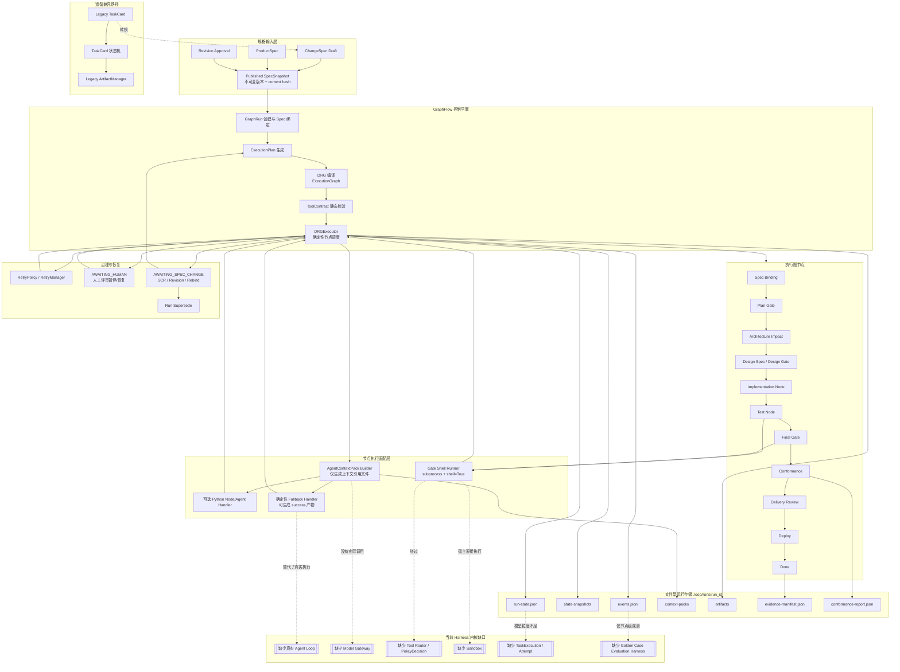
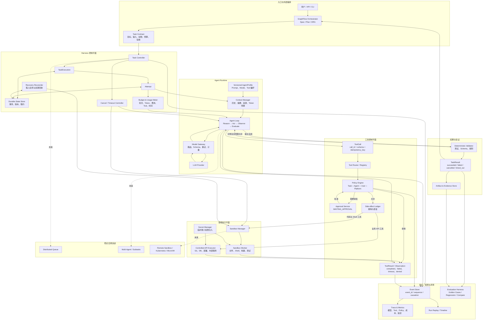
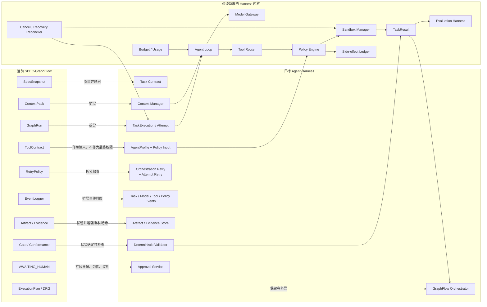
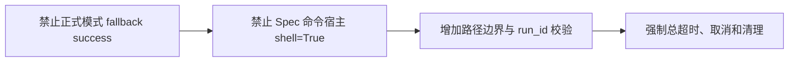
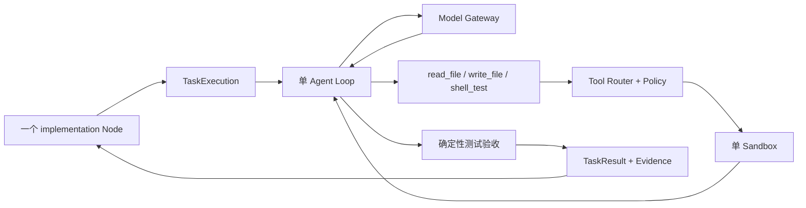

# 当前 SPEC-GraphFlow 与目标 Agent-Harness 架构对比

## 1. 阅读方式

本文包含三张架构图：

1. 当前项目的真实实现架构；
2. 标准 Agent-Harness 目标架构；
3. 从当前架构向 Harness MVP 演进的迁移关系。

图中的标记含义：

- `[保留]`：现有能力可以直接复用；
- `[重构]`：现有能力保留职责，但需要调整边界或数据模型；
- `[新增]`：当前不存在，是 Harness MVP 的核心建设项；
- `[风险]`：当前实现中必须优先关闭的危险路径；
- `[未来]`：不属于 MVP，可以在核心闭环稳定后演进。

---

## 2. 当前项目：SPEC-GraphFlow 真实架构



### 2.1 当前架构的本质

当前系统的强项在 GraphFlow 控制平面：它能够把 Spec 变成计划和执行图，并管理节点状态、重试、暂停、Artifact、Evidence 和 Conformance。

但节点内部仍不是 Agent-Harness：`AgentContextPack` 只准备输入引用，实际执行依赖可选 Python Handler；没有 Handler 时，系统会使用确定性 fallback 生成成功结果。验收 Shell 又直接运行在宿主工作区中。

因此当前的 `DONE` 主要表示“执行图已走完”，不必然表示“真实 Agent 已完成并通过工程验收”。

---

## 3. 标准 Agent-Harness 目标架构



### 3.1 标准 Harness 的职责边界

```text
GraphFlow 决定：做哪些 Task、依赖关系是什么、何时推进或回退。
Harness 决定：一个 Task 如何被 Agent 安全、可靠、可恢复地完成。
Agent 决定：下一步尝试什么动作。
Policy 决定：这个动作是否允许。
Executor 决定：如何在受控环境执行动作。
Validator 决定：结果是否客观满足验收条件。
```

---

## 4. 当前能力到目标架构的迁移图



---

## 5. 修订方向与优先级

### P0：先关闭当前危险路径



目标：让系统在缺少真实能力时 fail-closed，而不是产生虚假的 DONE。

### P1：建立第一个 Harness 纵向切片



目标：先证明一个真实工程 Task 能够安全完成、失败、取消、恢复和审计。

### P2：把 Harness 接回所有 GraphFlow 节点

- implementation、test、review、deploy 节点统一提交 Task；
- GraphFlow 不再理解 LLM 轮次和 ToolCall；
- Harness 不负责跨 Task 的业务编排；
- RetryPolicy 拆分为 GraphFlow 节点重试和 Harness Attempt 重试；
- AWAITING_HUMAN 扩展为绑定具体动作的 ApprovalRequest。

### P3：形成可持续演进基础设施

- Golden Case Evaluation Harness；
- 模型、Prompt、Agent、Tool、Policy 和 Runtime 版本闭包；
- CI 回归和发布门禁；
- 多 Worker、队列、租约和 Reconciler；
- 多 Agent、远程 Sandbox、Kubernetes 或 MicroVM。

---

## 6. 最关键的设计决策

后续修订时应坚持以下边界：

1. GraphFlow 保留为外层确定性编排，不承载 Agent 内部循环；
2. Harness 以 TaskExecution 为核心，而不是继续扩张 GraphRun；
3. AgentProfile 只声明能力偏好，不授予权限；
4. 所有 ToolCall 经过同一个 Tool Router 和 Policy Engine；
5. Shell、构建和测试必须进入 Sandbox；
6. 模型自称完成不能直接产生 succeeded，必须经过 Validator；
7. 重试必须区分新的 Attempt，并识别已经发生的副作用；
8. 每次运行必须固定完整版本闭包并可按事件回放；
9. MVP 先完成单 Task、单 Agent、单 Sandbox，再考虑多 Agent 和分布式。

