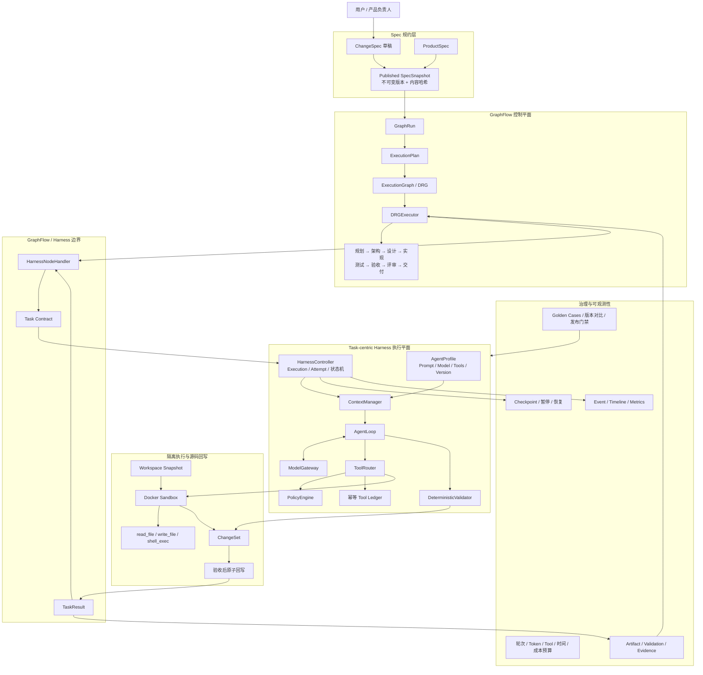
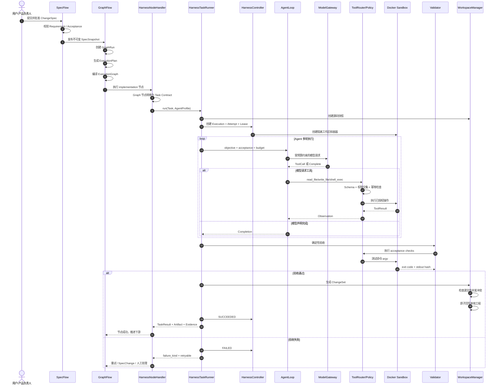

# 系统架构与任务执行时序

本文记录当前项目的系统架构以及单个 Task 从 Spec 进入 GraphFlow、由 Harness 执行并返回结果的主要过程。

设计原则可以概括为：

- Spec 定义目标、约束和验收标准；
- GraphFlow 负责编排任务及处理流程分支；
- Harness 负责受控运行单个 Task；
- Artifact、Validation 和 Evidence 负责证明结果。

两张图的独立 Mermaid 源文件位于：

- [`diagrams/system-architecture.mmd`](diagrams/system-architecture.mmd)
- [`diagrams/task-execution-sequence.mmd`](diagrams/task-execution-sequence.mmd)

## 系统架构图

## Task 执行时序图

## 图示边界

架构图描述的是当前代码已经形成的主要边界，不代表所有 GraphFlow 节点都已经接入正式 Harness。当前正式 Harness 主要接管 implementation、test、gate 和 plan_gate；review、deploy 仍需要真实生产 Handler。

时序图描述的是正式 Harness 路径。`smoke-flow` 使用确定性 mock 路径，其结果只能作为流程自检证据，不能替代真实模型执行、评审或部署证据。
